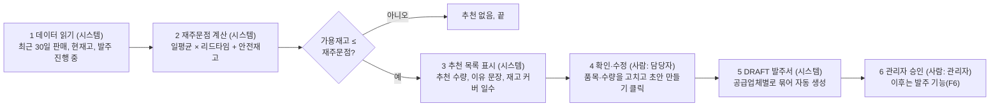

# AX 설계: AI 발주 추천 기능 명세와 검증 기준

Nov 2, 2026 · @우동현

## 설계 범위와 확정 결정

4단계는 MVP의 AI 기능을 "발주 추천" 하나로 좁혀서, 무엇을 입력받아 어떻게 계산하고 어떻게 보여줄지, 맞는지 어떻게 확인할지까지 정한다. 이 문서는 6단계 시스템 설계와 7단계 구현의 기준이 되며, 아직 코드는 만들지 않는다.

2026-11-02에 아래 세 가지를 확정했다. 표에 "제안"이라고 적힌 값은 이 문서에서 처음 정한 것이라 확정이 아니다.

| 결정 항목 | 확정 내용 | 이유 |
| --- | --- | --- |
| AX 필수 기능 | AI 발주 추천 1개 | 제안서의 AX 필수 후보. 재고 부족·과잉 탐지는 같은 계산에서 함께 나온다 |
| 일평균 판매량 기준 | 최근 30일 평균 | 가장 단순하고 면접에서 설명하기 쉽다. 계절 변화에 느린 점은 한계로 기록한다 |
| 추천 결과 표시 | 추천 목록 + 발주서 초안(DRAFT) 자동 생성. 승인은 사람이 한다 | 벤치마킹에서 찾은 GAP인 "재고에서 발주까지 한 번에 연결"을 직접 구현한다 |
| 자연어 질의 | MVP 제외, 후순위 | 발주 추천을 먼저 완성하고 검증하는 데 집중한다 |

## AX가 해결하는 문제

발주 추천은 문제 정의의 핵심 pain point인 "발주를 감으로 정한다(#1)"를 데이터 기반 판단으로 바꾸고, 벤치마킹에서 확인한 "재고에서 발주까지 연결" GAP을 메꾸는 기능이다. 다만 페르소나와 pain point는 아직 가설이고 인터뷰(5\~10명)로 검증하기 전이다.

| 연결 대상 | 내용 |
| --- | --- |
| 해결하는 pain point | #1 발주를 감으로 결정, #4 수기 발주서와 납기·단가 이력 없음(발주서 초안 생성으로 일부 해소) |
| 메우는 GAP | 재고 → 발주서 초안 자동 생성, 초보자도 쓸 수 있는 단순한 화면 |
| 사용자 | 김서연(구매·재고 담당)이 추천을 확인하고, 박정호(대표)는 승인한다 |

AX 우선순위 5개 중 MVP에 포함하는 것은 아래와 같다.

| 우선순위 | AX 후보 | MVP 처리 |
| --- | --- | --- |
| 1 | 재고 부족·과잉 탐지 | 포함. 발주 추천 계산 결과에서 함께 나온다 |
| 2 | 적정 발주량 추천 | 포함. 이 문서의 중심 기능 |
| 3 | 자연어 질의 | 제외, 후순위 |
| 4 | 주간 요약 | 제외, 후순위 (제안) |
| 5 | 공급망 리스크 알림 | 제외, 후순위 (제안) |

## 기능 개요와 사용자 흐름

발주 추천은 시스템이 부족한 품목과 수량을 계산해 보여주고, 구매·재고 담당자가 확인·수정해 발주서 초안을 만들며, 승인은 관리자가 하는 흐름이다.



색이 있는 상자는 시스템이 하는 일이고, 계산 결과 가용재고가 재주문점보다 크면 추천 없이 끝난다. 6번 승인 이후의 발주, 입고는 기존 발주 기능(F6)의 상태 흐름(DRAFT → APPROVED → ORDERED → RECEIVED)을 따른다.

## 입력 데이터와 계산 방식

추천은 AI 모델 없이 세 단계의 단순 공식으로 계산한다. 공식이라서 결과가 왜 나왔는지 숫자로 설명할 수 있고, 정답을 아는 시나리오로 확인하기도 쉽다. "제안"이라고 표시한 값은 이 문서에서 처음 정한 것으로, 사용자 테스트 후 바꿀 수 있다.

### 입력 데이터

| 입력 | 저장 위치 | 설명 |
| --- | --- | --- |
| 최근 30일 출고 수량 | 입출고 이력(InventoryMovements) | 조회 시점 직전 30일의 출고 합계. 판매 유형 출고만 판매량으로 본다(확정). 폐기·파손·기타 출고와 조정은 제외한다. 잘못 넣어 정정(CORRECTION)한 판매 수량은 뺀다(확정). 빼는 것은 그 판매를 `reverses_movement_id`로 가리키는 정정뿐이고, 기간은 원래 판매의 날짜로 판단한다(폐기·조정의 정정은 판매량과 무관, #30) |
| 현재고 | 입출고 이력 합계 | 입고 합계 − 출고 합계 |
| 발주 진행 중 수량 | 발주서 | ORDERED 상태에서 아직 입고되지 않은 수량 |
| 리드타임(일) | 공급업체 | 발주해서 받을 때까지 걸리는 날 수. 품목의 기본 공급업체 값을 쓴다(확정) |
| 안전재고 | 품목 | 판매가 예상보다 많을 때를 대비해 남겨두는 수량 |

### 계산 순서

1단계. 일평균 판매량을 구한다. 달력 기준 30일로 나눠 판매가 없는 날도 0으로 포함한다. 최근 30일은 오늘 포함 30일(오늘−29일 \~ 오늘)이다(확정).

```latex
\text{일평균 판매량} = \frac{\text{최근 30일 출고 합계}}{30}
```

2단계. 재주문점을 구하고, 가용재고가 재주문점 이하인지 확인한다. 가용재고는 현재고에 발주 진행 중 수량을 더한 값으로, 이미 주문해서 오는 중인 물건 때문에 또 추천이 뜨는 것을 막는다(임시 확정).

```latex
\text{재주문점} = \text{일평균 판매량} \times \text{리드타임} + \text{안전재고}
```

3단계. 추천 대상이면 추천 수량을 구한다. 목표 재고는 리드타임 동안과 그 뒤 14일 동안 팔 양에 안전재고를 더한 값으로, 보충 주기 14일은 임시값이다(임시 확정).

```latex
\text{추천 수량} = \text{일평균 판매량} \times (\text{리드타임} + 14) + \text{안전재고} - \text{가용재고}
```

### 숫자 예시

공통 조건은 30일 출고 300개(일평균 10개), 리드타임 5일, 안전재고 20개다. 재주문점은 10 × 5 + 20 = 70개로 세 품목 모두 같다.

| 품목 | 현재고 | 발주 진행 중 | 가용재고 | 판정 | 추천 수량 |
| --- | --- | --- | --- | --- | --- |
| A | 50개 | 0개 | 50개 | 70 이하라서 추천 | 10 × (5 + 14) + 20 − 50 = 160개 |
| B | 150개 | 0개 | 150개 | 70 초과라서 추천 없음 | 없음 |
| C | 50개 | 160개 | 210개 | 이미 주문해 오는 중이라 추천 없음 | 없음 |

품목 A는 재고가 5일치라 리드타임 5일과 같다. 화면에는 현재고 ÷ 일평균 판매량으로 구한 "재고 커버 일수"를 함께 보여주고, 리드타임 이하인 품목은 "품절 위험"으로 표시한다(임시 확정).

### 소수점과 올림 (확정)

일평균·재주문점·비교는 소수 그대로 계산하고, 최종 추천 수량만 올림(ceil)한다. 화면과 이유 문구의 일평균은 소수 첫째 자리까지 표시한다.

예) 30일 판매 7개, 리드타임 5일, 안전재고 2개, 가용재고 0개 → 일평균 7 ÷ 30 = 0.233…, 재주문점 0.233… × 5 + 2 = 3.17, 가용재고 0 ≤ 3.17이라 추천, 추천 수량 0.233… × 19 + 2 − 0 = 6.43 → 올림해서 7개(S12).

### 자세히 볼 점

- 최소 주문 수량, 포장 단위, 같은 공급업체 안에서 품목마다 다른 리드타임은 이 공식에 넣지 않는다. 필요성이 확인되면 확장한다.
- 과잉 재고 기준(며칠 치면 과잉인지)은 아직 정해지지 않았다. 장기재고 기준과 함께 열린 질문에 둔다.

## 출력과 화면

사용자는 "발주 추천" 화면에서 추천 품목과 그 이유를 보고, 버튼 하나로 공급업체별 발주서 초안(DRAFT)을 만든다. 초안을 만든 뒤의 수정·승인은 기존 발주 기능(F6)이 맡는다.

### 추천 목록 항목

| 항목 | 설명 |
| --- | --- |
| 품목명·SKU | 어떤 품목인지 |
| 현재고, 발주 진행 중 | 가용재고의 구성 요소 |
| 일평균 판매량(30일) | 계산의 출발점 |
| 재고 커버 일수 | 현재고로 며칠 버티는지 |
| 재주문점 | 발주 판단 기준선 |
| 추천 수량 | 사용자가 바꿀 수 있는 수량 |
| 공급업체 | 어느 업체 발주서에 들어가는지 |
| 상태 | 품절 위험(커버 일수 ≤ 리드타임) 또는 발주 필요(가용재고 ≤ 재주문점)(임시 확정) |
| 이유 | 한 문장 설명(아래) |

### 이유 설명 문구

이유는 AI가 새로 쓰는 글이 아니라, 계산에 쓴 숫자를 정해진 문장 틀에 끼워 맞춘다(확정). 그래야 숫자와 설명이 어긋날 수 없다. 일평균과 그 밖의 소수(리드타임 동안 필요량·재주문점)는 소수 첫째 자리까지, 정수는 그대로 쓴다. 문장 끝에 추천 수량을 붙인다(2026-11-04, #38에서 사용자 확인). 예를 들어 품목 A는 이렇게 표시된다.

```markdown
최근 30일 하루 평균 10개가 팔렸고 리드타임은 5일입니다. 리드타임 동안 50개가 필요하고 안전재고 20개를 더하면 70개입니다. 지금 가용재고는 50개라서 발주를 추천합니다. 추천 수량은 160개입니다.
```

### 발주서 초안 자동 생성 규칙

1. 담당자가 추천 목록에서 품목을 고르고 "발주서 초안 만들기"를 누른다. 버튼을 누르기 전에는 발주서가 만들어지지 않는다.
2. 공급업체가 같은 품목들은 한 장의 발주서로 묶는다(임시 확정).
3. 발주서의 수량은 추천 수량, 단가는 품목에 저장된 단가, 예상 납기는 오늘 + 리드타임으로 채운다(임시 확정).
4. 상태는 DRAFT로 만든다. APPROVED 이후는 기존 업무 규칙대로 관리자만 승인할 수 있다. AI가 승인하거나 발주를 대신 확정하지 않는다.
5. 같은 공급업체의 DRAFT 발주서가 이미 있으면 새로 만들지 않고 품목만 추가한다(임시 확정).
6. 발주서 초안에 들어간 품목은 추천 목록에 "초안 작성 중"으로 표시해 중복 추천을 막는다(임시 확정).

품목마다 기본 공급업체가 지정되어 있어야 2번 규칙이 동작한다. 이 필드는 품목의 필수 입력으로 확정했다.

## 예외 상황과 규칙

계산에 쓸 데이터가 부족하거나 이상할 때는 추천을 억지로 만들지 않고 "추천할 수 없는 이유"를 화면에 말해준다. 잘못된 추천보다 빠진 추천이 더 안전하다. 아래 처리 방법 중 "확정"이 붙지 않은 것은 제안이다.

제외 사유가 여러 개 겹치면 MISSING\_INFO(기본 공급업체 비활성) → INSUFFICIENT\_DATA(데이터 부족) → NO\_SALES\_30D(판매 없음) 순서로 첫 번째 하나만 보여준다(확정). 계산 함수와 추천 서비스는 오늘 날짜(today)를 인자로 받아서, 테스트에서 날짜를 고정할 수 있다.

| 상황 | 조건 | 처리 |
| --- | --- | --- |
| 기본 공급업체 비활성 | 품목의 기본 공급업체가 비활성 | 추천에서 제외하고 "기본 공급업체가 비활성입니다. 품목 정보를 확인하세요"로 안내한다(MISSING\_INFO, 확정). 리드타임·안전재고·기본 공급업체는 필수 칸이라 비어 있는 경우는 없다 |
| 판매 데이터 부족 | (오늘 − 첫 입출고 날짜) < 14일인 신규 품목 | "데이터 부족"으로 표시하고 추천을 계산하지 않는다(확정) |
| 최근 30일 판매 없음 | 30일 판매 합계(정정 반영 후)가 0 | 추천하지 않고 "최근 30일 판매 없음"으로 표시한다. 장기재고 후보로 볼 수 있다 |
| 이미 발주 진행 중 | ORDERED 상태에 미입고 수량이 있음 | 가용재고에 더해 계산한다(임시 확정) |
| 취소된 발주 | CANCELLED 상태 | 발주 진행 중 수량에서 빼고 계산한다(임시 확정) |
| 추천 수량이 0 이하 | 계산 결과가 0 또는 음수 | 추천하지 않는다 |
| 초안 만든 뒤 재고 변동 | 입출고로 가용재고가 바뀜 | 초안 수량은 그대로 두고, 추천 목록만 새로 계산한다. 수량 수정은 사용자가 한다 |
| 회사 데이터 분리 | 모든 계산 | 로그인한 회사의 company\_id 데이터만 사용한다 |

이상치 보정은 MVP에 포함하지 않는다. 하루에 평소의 10배가 출고된 날이 있어도 30일 평균에 그대로 포함되며, 이 한계는 뒤의 "한계와 확장"에 적는다.

## 검증 기준

발주 추천은 세 단계로 확인한다. 정답을 아는 시나리오로 계산이 맞는지, 공개 데이터로 현실적인 판매 흐름에서 말이 되는지, 사용자 테스트로 사람이 쓸 수 있는지를 본다. 실제 기업 데이터로는 검증하지 않으며, 이 점은 한계로 기록한다.

| 단계 | 방법 | 확인하는 것 | 시점 |
| --- | --- | --- | --- |
| 1. 정답 시나리오 | 정답을 아는 소수 품목 데이터로 계산 결과 비교 | 공식과 예외 처리가 문서대로 동작하는지 | 구현 중(테스트 코드) |
| 2. 공개 데이터 점검 | 공개 판매 이력을 넣고 과거 시점별로 추천 계산 | 추천이 실제 판매 흐름에서 말이 되는지 | 샘플 데이터 준비 후 |
| 3. 사용자 테스트 | 5\~10명이 대표 시나리오 수행 | 추천을 이해하고 발주서까지 만들 수 있는지 | 배포 후 |

### 1단계: 정답 시나리오

공통 조건은 일평균 10개, 리드타임 5일, 안전재고 20개이며, 다른 조건은 각 행에 적는다(S12는 공통 조건과 다른 값을 쓴다). 아래 시나리오는 모두 통과해야 한다. S12\~S14는 2026-11-03에 추가했다(임시 확정).

| 번호 | 상황 | 입력 | 기대 결과 |
| --- | --- | --- | --- |
| S1 | 재고 부족 | 현재고 50, 발주 진행 0 | 추천, 수량 160 |
| S2 | 재고 충분 | 현재고 150 | 추천 없음 |
| S3 | 이미 발주 중 | 현재고 50, ORDERED 160 | 추천 없음 |
| S4 | 취소된 발주 | 현재고 50, CANCELLED 160 | 진행 중 0으로 계산, 추천 160 |
| S5 | 판매 없음 | 30일 출고 0 | 추천 없음, "최근 30일 판매 없음" 표시 |
| S6 | 데이터 부족 | 첫 입출고 기록 후 13일(14일 미만) | "데이터 부족" 표시, 추천 없음 |
| S7 | 기본 공급업체 비활성 | 품목의 기본 공급업체가 비활성 | 추천 제외, excluded 코드 MISSING\_INFO, "기본 공급업체가 비활성입니다. 품목 정보를 확인하세요" 표시 |
| S8 | 회사 분리 | 회사 X로 로그인 | 회사 Y의 품목은 추천에 나타나지 않음 |
| S9 | 초안 묶기 | 같은 공급업체 품목 2개 선택 | DRAFT 발주서 1장, 품목 2줄 |
| S10 | 초안 중복 방지 | 같은 공급업체 DRAFT가 이미 있음 | 새로 만들지 않고 품목만 추가 |
| S11 | 승인 권한 | 담당자가 APPROVED 시도 | 막힘(관리자만 승인) |
| S12 | 소수 올림 | 30일 판매 7, 리드타임 5, 안전재고 2, 가용재고 0 | 추천, 수량 7(6.43 올림) (임시 확정) |
| S13 | 판매 정정 | SALE 100 + 그 SALE에 대한 CORRECTION 90 | 30일 판매 합계 10 (임시 확정) |
| S14 | 사유 겹침 | 첫 기록 10일 전, 30일 판매 0 | INSUFFICIENT\_DATA 표시(NO\_SALES\_30D 아님) (임시 확정) |

### 2단계: 공개 데이터 점검

과거 어느 날을 기준으로 추천을 계산하고, 그 뒤 리드타임 안에 가용재고가 0이 되었는지 비교한다. 두 가지를 센다.

- 놓친 품절: 실제로 부족해진 품목 중 추천이 미리 잡지 못한 비율
- 불필요한 추천: 추천했지만 실제로는 부족해지지 않은 비율

공개 데이터에는 재고와 리드타임이 없어 시작 재고와 리드타임은 직접 정한 값을 쓴다. 따라서 이 점검은 "공식이 현실적인 수요에서 말이 되는지"를 보는 용도이고, 정확도 보증으로 쓰지 않는다. 목표 수치는 처음 한 번 측정한 뒤에 정한다.

### 3단계: 사용자 테스트

대표 시나리오(품목 등록 → 입고 → 출고 → 부족 확인 → 발주 생성) 중 발주 추천 부분에서 아래를 기록한다(제안).

- 추천 목록에서 발주서 초안까지 만든 사람의 비율
- "이 추천 수량이 납득되나요?"에 대한 답, 이유 문구를 읽었는지
- 추천 수량을 고친 비율과 고친 방향(늘림/줄임)
- 막힌 지점과 걸린 시간

수량을 많이 고친다면 공식이나 보충 주기 14일을 바꿔야 한다는 신호다. 목표 수치는 첫 테스트 결과를 보고 정한다.

## 한계와 확장

이 추천은 단순한 규칙 기반 계산이라 맞는 상황이 분명하고 틀릴 상황도 분명하다. 한계를 미리 적어두고 사용자 테스트 결과로 확장 순서를 정한다.

### 한계

- 30일 평균은 계절 변화, 행사, 급증을 반영하지 못한다. 하루에 10배 팔린 날도 평균에 그대로 들어간다.
- 안전재고는 사용자가 정한 값이라 판매 변동이 큰 품목을 자동으로 더 넓게 잡지 않는다.
- 판매 출고만 판매량으로 쓰므로, 출고 등록 때 유형(판매/폐기·파손/기타)을 잘못 고르면 판매량이 틀어진다. 잘못 넣은 판매는 정정(CORRECTION) 이력으로 바로잡으면 판매량에서도 빠진다.
- 이력이 14\~29일인 품목은 ÷30 때문에 일평균이 낮게 나온다(예: 20일간 하루 10개 → 200 ÷ 30 = 6.7).
- 품목마다 따로 계산해서 같은 공급업체의 묶음 발주 이득, 최소 주문 수량은 고려하지 않는다.
- 실제 기업 데이터로 검증하지 않았고, 보충 주기 14일은 임시값이다.
- MVP의 추천 계산 자체는 수식이다. 면접에서 "AI가 무엇을 하는가"라는 질문을 받을 수 있어서, 이 부분은 아래 열린 질문으로 남긴다.

### 확장 후보

모두 MVP 이후에 다룬다. 출처가 제안서인 항목은 이미 후순위로 정해진 것이고, 제안은 이 문서에서 처음 내놓은 것이다.

| 확장 | 내용 | 출처 | 필요한 전제 |
| --- | --- | --- | --- |
| 자연어 질의 | "이번 달 재고 부족 품목 알려줘"처럼 말로 물어본다 | 제안서(후순위) | 다른 회사 데이터가 절대 안 섞이도록 company\_id 조건을 강제하는 안전장치 |
| 고급 수요예측 | 요일·계절을 반영해 판매량을 예측한다 | 제안서(후순위) | 충분한 기간의 판매 이력 |
| 주간 요약 | 지난주 입출고와 부족 품목을 정리해준다 | 제안서(AX 우선순위 4) | 안정적인 데이터 조회 |
| 공급망 리스크 알림 | 납기 지연이 잦은 공급업체를 알려준다 | 제안서(AX 우선순위 5) | 발주·입고 납기 이력 |
| 이유 문구를 LLM으로 다듬기 | 계산 결과는 그대로 두고 설명 문장만 자연스럽게 바꾼다. 숫자는 LLM이 만들지 않는다 | 제안 | 계산 결과를 그대로 넘기는 구조, 숫자 일치 검사 |
| 품목별 보충 주기·최소 주문 수량 | 품목마다 다른 보충 주기와 최소 수량을 쓴다 | 제안 | 사용자 테스트에서 수량 수정이 잦은 품목 확인 |

## 열린 질문과 다음 단계

아래 질문 중 1, 2, 3, 5a, 7번은 2026-11-03에 확정했다. 나머지는 코드를 만들기 전에 정해야 한다. 이 중 1번과 2번은 5단계 MVP 범위 확정에서 반드시 결정한다.

| 번호 | 질문 | 제안 | 결정 시점 |
| --- | --- | --- | --- |
| 1 | 추천 계산은 규칙으로만 할지, 이유 문구에 LLM을 쓸지 | 확정: 계산과 이유 문구는 규칙 기반 문장 틀, LLM 다듬기는 Could | 5단계 |
| 2 | 품목에 기본 공급업체 필드가 필요한가 (F3 영향) | 확정: 품목마다 기본 공급업체 1개 지정, 필수 입력 | 5단계 |
| 3 | 판매량에 포함할 출고 유형 | 확정: 판매 출고만 포함. 출고 유형(판매/폐기·파손/기타)과 조정을 구분해 기록 | 6단계(ERD) |
| 4 | 과잉재고·장기재고 기준 | 미정. 기획 문서의 열린 질문과 같이 맞추기 | 구현 전(F7 이슈) |
| 5a | 데이터 부족 기준 14일 | 확정(사용자, 2026-11-03): (오늘 − 첫 입출고 날짜) < 14일이면 데이터 부족 | 확정됨 |
| 5b | 보충 주기 14일 | 임시값으로 시작하고 사용자 테스트로 조정 | 테스트 후 |
| 6 | 추천 계산 시점 | 화면을 열 때 계산. 품목 수가 적어 미리 계산할 필요가 없다 | 6단계 |
| 7 | 리드타임을 품목별로만 둘지, 공급업체별도 둘지 | 확정: 공급업체별로 저장. 품목의 리드타임 = 기본 공급업체의 리드타임 | 6단계 |

### 다음 단계

1. 5단계 MVP 범위 확정: 위 1·2번을 결정하고, 발주 추천을 AX 필수 기능으로 확정해 완료 기준을 정한다.
2. GitHub 이슈: 발주 추천을 `ax` 라벨의 이슈로 추가하고, 정답 시나리오 S1\~S11을 완료 기준으로 옮긴다.
3. 6단계 시스템 설계: 추천 계산에 필요한 조회(최근 30일 출고 합계, 발주 진행 중 수량)를 ERD와 API에 반영한다.
4. 인터뷰 질문지에 발주 판단 방식을 묻는 질문(발주 시점을 어떻게 정하는지, 보충 주기는 어느 정도인지)을 추가해 공식의 가정을 검증한다.
