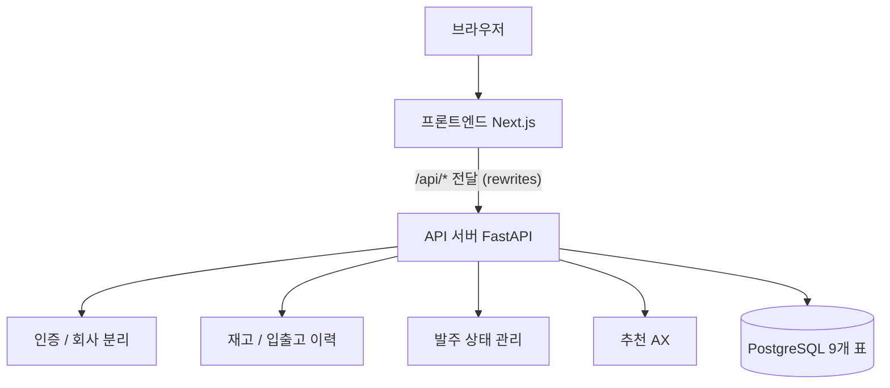

# 아키텍처 설계: 기술 스택·구성·배포

2026-11-03 (초안, 검토 전)

## 스택 제안과 이유

기술 스택은 사용자가 판단을 맡겨 11월 3일에 아래 제안을 임시 확정했다(클라우드 제외). 나중에 바꿀 수 있다. 아래는 제안서의 권장 스택에서 고른 것이다. 기준은 세 가지다. 혼자 만들어 8주 안에 배포까지 갈 수 있어야 하고, ERD가 요구하는 DB 기능(부분 고유 인덱스, CHECK, 행 잠금)을 써야 하고, AX 계산 코드와 사용자 테스트 데이터 분석이 같은 언어로 이어지면 좋다.

| 영역 | 제안 | 이유 | 대안 | 상태 |
| --- | --- | --- | --- | --- |
| 백엔드 | Python + FastAPI | 추천 계산·데이터 점검을 같은 언어로 작성. 요청·응답 형태를 타입으로 적어 API 문서가 자동으로 나온다 | Django(관리자 화면·인증이 기본 내장, 대신 구조가 더 무겁다) | 임시 확정 |
| DB | PostgreSQL | ERD의 부분 고유 인덱스·CHECK·행 잠금을 그대로 쓸 수 있다 | SQLite는 동시 출고 차단을 검증하기 어려워 개발 연습용에만 | 임시 확정 |
| DB 접근 | SQLAlchemy + Alembic | 표 변경을 마이그레이션 파일로 남겨 ERD와 실제 DB가 어긋나지 않게 한다 | 직접 SQL(추천 조회 3개는 SQL 그대로 써도 된다) | 임시 확정 |
| 프론트 | Next.js(React) + TypeScript | 제안서 권장. 목록·폼·대시보드 위주의 화면이라 표준적인 구조로 충분하다 | 서버 렌더링 템플릿(프론트 학습 부담이 가장 적다, 대신 화면 상호작용은 약하다) | 임시 확정 |
| 인증 | 비밀번호 해시 저장 + 서명된 토큰을 httpOnly 쿠키로(SameSite=Lax, 배포 환경에서는 Secure) | 화면 스크립트가 토큰을 읽지 못하게 한다. 토큰에 user\_id·company\_id·role을 담는다(API 문서의 원칙) | 서버 세션 | 임시 확정(쿠키 설정은 확정) |
| 추천 계산 | API 요청이 올 때 서버(Python)에서 계산, 저장 안 함 | ERD에서 정한 조회 3개 결과로 수식을 계산. 항상 최신 이력 기준이라 결과가 어긋날 일이 없다 | 배치로 미리 계산해 저장(품목이 많아지면) | 임시 확정 |
| LLM | 공통 래퍼 `app/services/llm.py`(#180) 하나로만 호출하고, 공급자는 Gemini REST(`llm_gemini.py`, 표준 urllib, 키는 `x-goog-api-key` 헤더로만). 기본은 꺼짐(`LLM_ENABLED`·회사별 일일 호출 수·월 비용 한도 중 하나라도 0이거나 `LLM_API_KEY`·`LLM_MODEL`이 비면 꺼짐). 429·5xx·시간 초과는 짧게 재시도하고, 그래도 실패하면 503 `LLM_UNAVAILABLE`로 수동 입력 안내. 출력은 스키마 검증 → 서버 규칙 검증 → 사용자 확인을 거친다. **무료 키는 입력·출력이 구글의 제품 개선·모델 개발에 쓰이고 사람이 검수할 수 있어 민감 데이터(실제 고객·거래처·가격 등)를 보내지 않는다. 실제 고객 데이터는 결제를 연결한 유료 키가 필요하다.** 무료 등급에서 쓸 수 있는 모델과 한도 숫자는 확인 못함 | LLM은 틀릴 수 있어 계산·저장을 맡기지 않고 제안만 받는다. 이유 문구는 문장 틀이 확정이다 | 공급자 SDK(새 라이브러리라 쓰지 않음) | 확정(방향), 공급자는 Gemini로 시작(임시 확정) |
| 배포 | Docker 컨테이너 → 관리형 서비스에 배포 + 관리형 PostgreSQL | 서버를 직접 운영하지 않는다. 클라우드는 GCP 또는 AWS 중 하나(미정), 요금·무료 한도는 배포 직전에 확인한다 | 프론트만 정적 호스팅 서비스 | 임시 확정(클라우드는 미정) |
| CI | GitHub Actions: 테스트·린트·빌드 | 3주차에 맨 먼저 설정. 정답 시나리오 S1\~S14가 PR마다 자동으로 돌아간다 | — | 임시 확정 |

초보자가 혼자 하기에 부담이 되는 부분은 프론트와 배포다. 그래서 일정이 밀리면 화면을 단순하게 하고(대시보드를 표 위주로), 서버와 DB의 규칙 부분은 줄이지 않는 순서를 제안한다. 이 표는 CLAUDE.md §6에 임시 확정으로 옮겨 두었다.

## 전체 구조



서버는 하나로 두고 안에서 역할별 모듈로 나눠 만든다. 작은 프로젝트에서 서비스를 나눠 운영하는 것은 리스크가 더 크다. 규칙(회사 분리, 음수 재고 차단, 상태 변경)은 전부 이 서버 안에서 검사하고, 프론트는 검사 결과를 보여주기만 한다.

### 쿠키 인증 보안 (확정)

- 브라우저는 Next.js 주소로만 요청한다. Next.js가 `/api/*` 요청을 FastAPI로 전달한다(rewrites). 브라우저 입장에서는 같은 주소라 CORS 설정이 필요 없다.
- 로그인 쿠키는 httpOnly(화면 스크립트가 못 읽음), SameSite=Lax(다른 사이트에서 보낸 POST에는 쿠키가 안 붙음), 배포 환경에서는 Secure(HTTPS에서만 전송)로 둔다.
- 상태를 바꾸는 요청은 POST/PATCH만 쓰고, GET은 읽기만 한다. SameSite=Lax는 다른 사이트에서 오는 GET 이동에는 쿠키를 붙이므로, GET이 아무것도 바꾸지 않아야 CSRF(다른 사이트가 사용자 쿠키로 요청을 보내는 공격)를 막을 수 있다.
- 한계: 토큰은 서버에 저장하지 않으므로, 로그아웃은 쿠키를 지울 뿐이다. 토큰이 유출되면 만료(8시간) 전까지는 쓸 수 있다. 직원을 비활성으로 바꾸면 요청마다 사용자 상태를 확인하므로 즉시 막힌다.

## 서버 내부 구성과 규칙이 사는 자리

서버 코드는 세 층으로 나눈다. 경로를 받는 층(api), 업무 규칙을 지키는 층(services), 표와 대화하는 층(models)이다. 규칙이 services에만 있으면 나중에 화면이나 경로가 바뀔 때도 규칙은 그대로다.

```text
backend/
  app/
    main.py        # 앱 시작점, 경로를 모아 등록
    api/           # 경로마다 요청을 받아 services를 부르기만 하는 층
    services/      # 업무 규칙: 재고, 발주 상태, 추천 계산
    models/        # 표(ERD의 9개)를 코드로 정의
    schemas/       # 요청·응답 형태(API 문서의 JSON)
    auth/          # 로그인, 토큰에서 회사·역할 읽기
  migrations/      # 표 변경 이력(Alembic)
  tests/           # S1~S11 등 자동 테스트
```

| 규칙 | 지키는 자리 | 방법 |
| --- | --- | --- |
| 회사 분리(R1) | auth + 모든 service | auth가 토큰에서 company\_id를 꺼내 service 함수의 첫 번째 인자로 넘긴다. 모든 조회·저장에 이 값이 들어간다. 인자를 빼먹으면 함수가 호출되지 않는다. 행 찾기·참조 검사·목록은 `services/tenant.py`의 `get_owned`·`check_ref`·`scoped`만 쓴다(#23) |
| 재고·음수 차단(R2, R3) | services/stock | 이력을 쓰는 함수를 한 곳(`register_movement`)만 둔다. 트랜잭션 안에서 품목 줄을 잠그고 합계를 확인한다. 발주 입고와 정정(CORRECTION)도 이 함수를 재사용한다 |
| 발주 상태(R5) | services/purchase\_orders | "어느 상태에서 어느 상태로 갈 수 있는지"를 표 하나로 적고 모든 상태 변경이 그 표를 거친다. 승인은 역할 검사를 함께 한다 |
| 추천(F8) | services/recommendations(조회·초안), services/recommend(순수 함수), services/inventory\_status(재고 목록 상태) | 조회(ERD)는 `recommendations.py`의 `calculate_for`가 데이터만 가져오고, 수식은 DB를 모르는 순수 함수(`recommend.py`의 `calculate_recommendation`, 부족·과잉 판정 `stock_status`·`is_overstock`)로 분리해 테스트한다. 재고 목록·대시보드도 같은 `calculate_for`를 써서 추천과 같은 답을 낸다(#76). service와 순수 함수 모두 오늘 날짜(today)를 인자로 받는다 |
| 마지막 방어 | DB 제약 | 부분 고유 인덱스와 CHECK(ERD)가 코드가 놓친 경우를 막는다 |

추천 수식을 순수 함수로 분리한 모양은 아래와 같다(예시: 일평균 10, 리드타임 5, 안전재고 20, 현재고 50 → 재주문점 70, 수량 160). 오늘 날짜를 인자로 받으므로 테스트는 날짜를 고정해서 돌린다.

```python
import math                                   # 추천 수량을 올림(ceil)할 때 쓴다

def calculate_recommendation(today, first_movement_date, supplier_active,
                             sales_30d, stock, in_transit, lead_time, safety_stock, cycle=14):
    if not supplier_active:                   # 1순위: 기본 공급업체가 비활성이면
        return {"excluded": "MISSING_INFO"}   # 품목 정보 확인 필요로 제외한다 (S7)
    if first_movement_date is None or (today - first_movement_date).days < 14:  # 2순위: 기록이 없거나 첫 입출고 후 14일이 안 됐으면
        return {"excluded": "INSUFFICIENT_DATA"}   # 데이터 부족으로 제외한다 (S6, S14)
    if sales_30d <= 0:                        # 3순위: 최근 30일 판매(정정 반영 후)가 없으면
        return {"excluded": "NO_SALES_30D"}   # 판매 없음으로 제외한다 (S5)
    avg = sales_30d / 30                      # 일평균 판매량, 소수 그대로 (예: 300 ÷ 30 = 10, 7 ÷ 30 = 0.233…)
    available = stock + in_transit            # 가용재고 = 현재고 + 진행 중 발주 (예: 50 + 0)
    reorder_point = avg * lead_time + safety_stock   # 재주문점, 소수 그대로 (예: 10 × 5 + 20 = 70)
    if available > reorder_point:             # 가용재고가 재주문점보다 크면
        return None                           # 추천하지 않는다
    raw = avg * (lead_time + cycle) + safety_stock - available  # 올림 전 추천 수량 (예: 10 × 19 + 20 − 50 = 160)
    quantity = math.ceil(raw)                 # 최종 추천 수량만 올림한다 (예: 6.43 → 7)
    if quantity <= 0:                         # 추천 수량이 0 이하면
        return None                           # 추천하지 않는다
    return {"reorder_point": reorder_point, "quantity": quantity}   # 재주문점과 수량을 돌려준다
```

제외 사유가 겹치면 위 순서대로 MISSING\_INFO → INSUFFICIENT\_DATA → NO\_SALES\_30D 중 첫 번째 하나만 낸다(확정). 일평균·재주문점·비교는 소수 그대로 계산하고, 최종 추천 수량만 올림한다(확정). 예) 30일 판매 7, 리드타임 5, 안전재고 2, 가용재고 0 → 일평균 0.233…, 재주문점 3.17, 추천 수량 6.43 → 7(S12). 화면·이유 문구의 일평균은 소수 첫째 자리까지 표시한다. 보충 주기 14일은 임시값이다(인터뷰·측정 후 조정). 위 코드는 설명을 위한 예시다. 실제 구현(`backend/app/services/recommend.py`, #38)은 float 오차를 피하려고 분수(`Fraction`)로 계산하고, 추천하지 않는 품목도 `None` 대신 계산 숫자(일평균·가용재고·재주문점)를 돌려준다(부족 판정을 재고 목록·대시보드가 같은 함수로 하도록).

## 요청 흐름 예

### 출고 등록 (음수 재고 차단)

1. 브라우저가 Next.js 주소로 `POST /api/v1/inventory-movements`를 보낸다(쿠키가 자동으로 붙는다). Next.js가 이 요청을 FastAPI로 전달한다.
2. auth가 토큰을 확인해 사용자·회사·역할을 꺼낸다. 토큰이 없으면 401이다.
3. 요청 형태를 검사한다(수량 1 이상, SALE이면 채널 필수). 어긋나면 422다.
4. services/stock이 트랜잭션을 열고 그 회사의 품목 줄을 잠근다. 회사 안에 없는 품목이면 404다.
5. 현재고(이력 합계)를 읽고 빼고 남는 값이 0 미만이면 저장 없이 트랜잭션을 되돌리고 409 `INSUFFICIENT_STOCK`을 돌려준다.
6. 아니면 이력 한 줄을 저장하고 트랜잭션을 닫는다(잠금이 풀린다). 동시에 온 다른 출고는 여기서부터 재고를 다시 읽는다.
7. 201과 함께 등록된 이력과 등록 직후 재고를 돌려준다.

### 추천 조회와 초안 생성

1. 화면이 추천 화면을 열 때 `GET /recommendations`를 보낸다.
2. services/recommendations가 오늘 날짜(today)를 받아, 회사의 활성 품목마다 조회 3개(현재고, 정정을 뺀 최근 30일 판매 합계, 진행 중 발주)와 첫 입출고 날짜를 읽는다. 품목이 많아도 조회는 품목 목록을 한 번에 묶어 가져와 품목당 질문을 반복하지 않는다.
3. 품목마다 MISSING\_INFO(기본 공급업체 비활성) → INSUFFICIENT\_DATA → NO\_SALES\_30D 순서로 검사해 처음 걸린 하나만 excluded로 보내고, 나머지만 순수 함수로 계산한다.
4. 이유 문구는 문장 틀에 숫자를 끼워 만든다. 결과는 저장하지 않고 돌려준다.
5. 사용자가 품목을 고르고 수량을 고친 뒤 `POST /recommendations/drafts`를 보낸다.
6. 서버가 그 품목의 추천을 다시 계산해 추천 수량·이유를 발주 품목 줄에 저장하고, 공급업체별로 DRAFT 발주서를 만들거나 기존 초안에 추가한다. 동시에 두 명이 같은 공급업체의 초안을 만들면 회사 행을 먼저 잠가 요청을 한 줄로 세우므로, 두 번째 요청은 첫 번째가 만든 초안에 품목을 더한다(#40). 부분 고유 인덱스는 코드가 놓친 경우를 막는 마지막 방어다.

추천 계산은 읽기만 하므로 잠금이 필요 없다. 품목이 아주 많아져 느려지면 그때 결과를 미리 계산해 두는 방식을 검토한다(처음부터 하지 않는다).

## 배포·환경·운영

Docker와 GitHub Actions는 임시 확정이고, 나머지는 제안이다.

| 항목 | 제안 |
| --- | --- |
| 환경 | 로컬(내 컴퓨터), 배포(서비스 URL) 두 개로 시작. 테스트용 포트폴리오 시연 데이터는 배포 환경에 따로 넣는다 |
| 비밀값 | DB 주소, 토큰 서명 키 같은 값은 환경 변수로만 넣고 GitHub에 올리지 않는다. 저장소에는 예시 파일(`.env.example`)만 둔다 |
| 로컬 실행 | Docker로 DB와 서버를 한 번에 띄운다. 다른 로컬로 옮겨도 같은 명령으로 시작한다 |
| 표 변경 | 수동으로 고치지 않고 마이그레이션 파일로만 바꾼다. 배포 때도 같은 파일을 실행한다 |
| CI/CD | PR마다 테스트·린트 자동 실행(3주차). main에 합칠 때 자동 배포는 배포 설정이 끝난 뒤(7주차) 여부를 정한다 |
| 백업 | 관리형 DB의 자동 백업을 켜고, 복구를 한 번 시험해 본다. 재고는 이력 합계라 이력이 전부다 |
| 로그 | 요청 경로·상태 코드·오류 code를 남긴다. 비밀번호·토큰은 로그에 남기지 않는다 |

### 테스트 계층

계산 함수 테스트는 DB 없이 빠르게, 재고·발주 규칙 테스트는 실제 DB로 돌린다. 시나리오 S1\~S7·S12·S14는 순수 함수와 추천 service에서, S8·S11은 API 수준에서, S9·S10·S13은 DB까지 쓰는 테스트로 확인한다. 추천 테스트는 today를 고정한 날짜로 넘겨 돌린다. 동시 출고 차단(R3)은 스레드 두 개로 같은 품목에 동시에 출고를 보내 한 건만 성공하는지 본다.

## 주차별 구현 순서와 열린 질문

제안서의 8주 틀과 MVP 범위 문서의 일정을 그대로 따른다. 구현은 "그 주에 화면까지 동작하는 것"을 기준으로 자른다. 실제 속도는 3주차 끝에 점검하고 밀리면 C1을 빼는 것부터 한다.

| 주차 | 구현 | 끝났다고 할 기준 |
| --- | --- | --- |
| 3 | 저장소 토대(백엔드·프론트·DB 띄우기), 마이그레이션, 로그인·회사 분리, 공급업체·품목 CRUD(F1\~F3), CI | 로컬에서 회사를 만들고 로그인해 품목을 등록, S8 통과 |
| 4 | 입출고·재고 조회(F4, F5), 음수 재고 차단, 재고 조정, 정정 이력 | 동시 출고 테스트 통과, 현재고 = 이력 합계 |
| 5 | 발주 상태·입고(F6), 대시보드(F7) | 초안부터 입고 완료까지 한 바퀴, S11 통과 |
| 6 | 발주 추천(F8), 초안 생성, (여유가 있으면 C1) | S1\~S10·S12\~S14 통과, 화면에서 추천→초안 |
| 7 | 배포, 사용자 테스트 준비, 샘플 데이터 | 서비스 URL에서 대표 시나리오 통과 |
| 8 | README·시연 영상·정리 | 포트폴리오 항목 충족 |

### 열린 질문

- 스택 표(FastAPI, PostgreSQL, Next.js 등)는 임시 확정이다. 구현이 어려우면 프론트를 단순하게 하는 쪽으로 바꾼다.
- 추천 계산 시점은 "요청이 올 때 계산"으로 임시 확정했다(ERD 열린 질문 4).
- 토큰 만료 시간은 8시간이다(`auth/security.py`의 `TOKEN_HOURS`, #22). 임시 비밀번호 첫 로그인 변경은 MVP에서 하지 않는다(후순위).
- 프론트 화면은 별도 설계 작업 없이 기획 문서의 화면 흐름으로 바로 구현하고, 필요할 때 보충한다(임시 확정).
- 배포 대상 클라우드(GCP 또는 AWS)와 월 비용 상한은 아직 미정이다. 배포 직전(7주차)에 비교해 정한다.

스택을 임시 확정했으므로, 구현하면서 ERD·API 문서의 스택과 무관한 표현을 그 스택의 용어로 정리하고, GitHub 이슈에 구현 단위로 나눠 넣는다.
