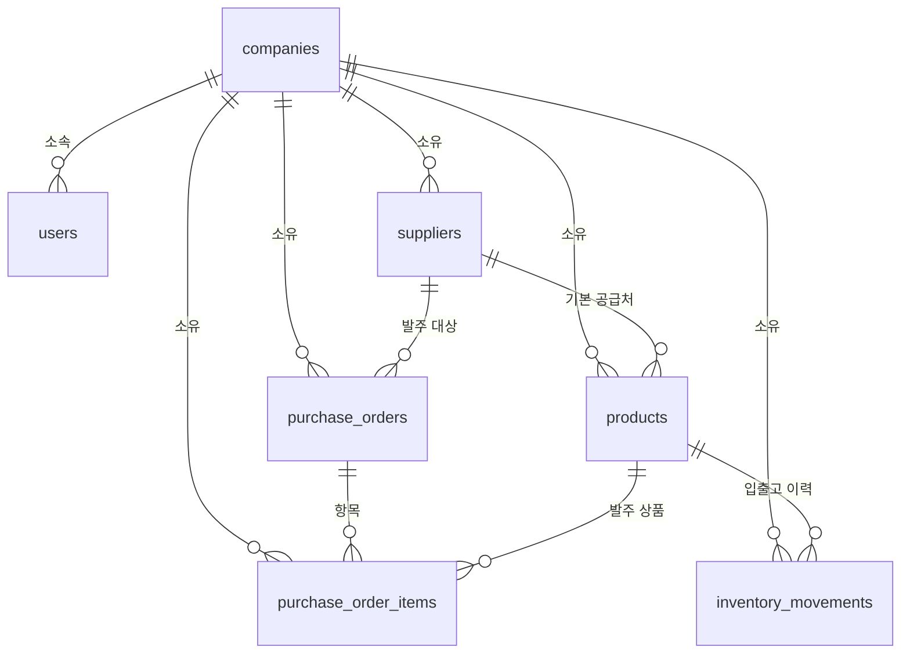

# ERD 설계: 데이터 구조와 업무 규칙 반영

2026-11-03 (초안, 검토 전)

## 설계 범위와 전제

MVP의 데이터는 표 7개로 충분하고, 재고 수량은 따로 저장하지 않고 입출고 이력의 합계로 계산한다. 이 문서는 3단계 기획의 업무 규칙(R1\~R10), 4단계 AX 설계의 추천 계산, 이슈 #2\~#12에 반영한 확정 사항을 표와 제약으로 옮긴다. 코드는 아직 만들지 않으며, API와 아키텍처는 이 문서 다음에 정한다.

| 구분 | 내용 |
| --- | --- |
| 확정으로 받은 것 | 리드타임은 공급업체에 저장, 품목의 기본 공급업체는 필수 1개, 출고 유형(판매/폐기·파손/기타)과 실사 조정 이력(사유 필수), 공급업체·품목은 삭제하지 않고 항상 비활성으로 바꾼다(삭제 기능은 없다), 부분 입고 후 취소 불가, 발주 없는 직접 입고 허용, 승인은 관리자만, 입출고 이력 수정·삭제 불가(실수는 정정 이력 CORRECTION으로 바로잡음), 최근 30일 = 오늘 포함 30일 |
| 이 문서에서 처음 정한 것 | 표 7개 구성(재고 저장 표, 추천 결과 표, 상태 로그 표를 두지 않음), 발주 품목에 추천 수량 기록, PostgreSQL에서 쓰는 제약 문법. 사용자가 판단을 맡겨 2026-11-03에 임시 확정했고, "(임시 확정)"으로 표시한다 |

기술 스택은 FastAPI + PostgreSQL + Next.js로 임시 확정했다(아키텍처 문서). 아래 제약 문법은 PostgreSQL 기준이다.

## 표 목록과 역할

표는 회사, 사용자, 공급업체, 품목, 발주서, 발주 품목, 입출고 이력의 7개다. 표 이름은 소문자 복수형(snake\_case)이고, 이슈에 쓴 InventoryMovements는 inventory\_movements와 같은 표다(임시 확정).

| 표 | 한글 이름 | 역할 | 행이 생기는 때 | 고칠 수 있는가 |
| --- | --- | --- | --- | --- |
| companies | 회사 | 서비스를 쓰는 회사 한 곳. 모든 데이터의 울타리(R1) | 회사 가입 | 수정 가능, 삭제 없음 |
| users | 사용자 | 로그인 계정과 역할(관리자, 담당자) | 관리자가 직원 계정 생성 | 역할 변경·비활성 |
| suppliers | 공급업체 | 발주 대상, 리드타임(일)을 여기서 가진다 | 구매 담당 등록 | 수정 가능, 삭제 없이 항상 비활성 |
| products | 품목 | SKU, 단가, 안전재고, 기본 공급업체 | 품목 등록 | 수정 가능, 삭제 없이 항상 비활성 |
| purchase\_orders | 발주서 | 공급업체 한 곳에 보내는 발주 한 장. 상태와 승인 기록을 가진다 | 직접 작성 또는 추천에서 초안 생성 | 상태만 정해진 순서로 이동 |
| purchase\_order\_items | 발주 품목 | 발주서의 품목 한 줄(수량, 단가, 추천 수량) | 발주서 작성 | DRAFT일 때만 수정(임시 확정) |
| inventory\_movements | 입출고 이력 | 재고를 바꾸는 모든 사건. 현재고의 유일한 근거(R2) | 입고·출고·조정·정정 등록 | 수정·삭제 불가(확정) |

일부러 두지 않은 표도 있다. 세 가지 모두 필요성이 생기면 그때 추가한다(임시 확정).

- 재고 수량 표: 이력 합계와 어긋날 수 있어 R2를 깨뜨린다. MVP 규모에서는 합계 계산으로 충분하다.
- 추천 결과 표: 추천은 화면을 열 때 계산한다. 수량 수정 비율을 재는 데 필요한 값은 발주 품목에 남긴다.
- 발주 상태 로그 표: 승인자와 승인 시각은 발주서 칸으로 남기므로 MVP에서는 필요 없다.

다른 회사 행 연결은 서버가 막는다(#23). DB 수준 복합 외래키(company\_id, id)는 확장 후보다.

공급업체의 납기·단가 이력(F2)도 따로 표를 두지 않는다. 발주서의 약속 납기와 단가, 입출고 이력의 실제 입고일을 합쳐 보여준다.

## ERD 그림



회사가 모든 표의 기준이고, 재고 계산의 근거는 품목에 쌓이는 입출고 이력이다. 발주는 공급업체 아래 발주서가 있고 그 안에 품목 줄이 있다.

## 표별 칸 설명

표마다 칸이름, 형식, 필수 여부, 의미와 규칙을 정했다. 모든 표에 공통으로 id(행 번호), created\_at(만든 시각), updated\_at(고친 시각)가 있고, companies를 제외한 모든 표에 company\_id(소속 회사)가 있다. 아래 표에는 이 공통 칸을 다시 적지 않는다. 형식은 정수, 문자열, 날짜, 시각, 참/거짓, 선택지(정해진 값 중 하나)로 적는다. 금액은 원 단위 정수로 저장한다(임시 확정).

### companies (회사)

| 칸 | 형식 | 필수 | 의미와 규칙 |
| --- | --- | --- | --- |
| name | 문자열 | 필수 | 회사명 |
| business\_number | 문자열 | 선택 | 사업자등록번호. 숫자 10자리만 저장(입력의 하이픈은 서버가 지운다). DB CHECK로도 막는다(#156) |
| representative | 문자열 | 선택 | 대표자 |
| address | 문자열 | 선택 | 주소 |
| phone | 문자열 | 선택 | 대표 연락처 |

회사 정보 칸은 발주서 문서(#157) 머리말에 쓴다. 관리자만 수정한다.

### users (사용자)

| 칸 | 형식 | 필수 | 의미와 규칙 |
| --- | --- | --- | --- |
| company\_id | 정수 | 필수 | 소속 회사(companies를 가리킴) |
| name | 문자열 | 필수 | 사용자 이름 |
| email | 문자열 | 필수 | 로그인 ID. 전체 회사를 통틀어 중복 불가 |
| password\_hash | 문자열 | 필수 | 비밀번호를 암호화한 값. 비밀번호 원문은 저장하지 않는다 |
| role | 선택지 | 필수 | ADMIN(관리자), STAFF(담당자) 중 하나. 읽기 전용 역할 등은 인터뷰 후 필요하면 추가한다(임시 확정) |
| is\_active | 참/거짓 | 필수 | 기본 참. 거짓이면 로그인 불가 |

회사마다 활성 ADMIN이 최소 1명이어야 한다. 마지막 관리자의 역할 변경·비활성은 서버에서 막는다(F1).

### suppliers (공급업체)

| 칸 | 형식 | 필수 | 의미와 규칙 |
| --- | --- | --- | --- |
| company\_id | 정수 | 필수 | 소속 회사 |
| name | 문자열 | 필수 | 업체명. 회사 안에서 중복 불가 |
| contact\_name | 문자열 | 선택 | 담당자 |
| phone | 문자열 | 선택 | 연락처 |
| email | 문자열 | 선택 | 이메일 |
| memo | 문자열 | 선택 | 메모 |
| payment\_terms | 문자열 | 선택 | 지불조건 기본값(#156). 발주서 문서에 쓴다 |
| lead\_time\_days | 정수 | 필수 | 발주해서 받을 때까지 걸리는 일수. 0 이상. 이 업체 품목들이 함께 쓴다 |
| is\_active | 참/거짓 | 필수 | 기본 참. 삭제하지 않고 항상 비활성으로 바꾼다. 비활성 업체는 새 발주에만 안 나온다(아래 "비활성의 효과"). 기존 발주·품목 연결은 유지 |

### products (품목)

| 칸 | 형식 | 필수 | 의미와 규칙 |
| --- | --- | --- | --- |
| company\_id | 정수 | 필수 | 소속 회사 |
| sku | 문자열 | 필수 | 품목 코드. 회사 안에서 중복 불가 |
| name | 문자열 | 필수 | 품목명 |
| unit | 문자열 | 필수 | 단위(개, 박스 등) |
| unit\_cost | 정수 | 필수 | 구매 단가(원). 0 이상. 발주 품목의 단가 기본값으로 쓴다 |
| units\_per\_box | 정수 | 선택 | 박스 하나의 재고 단위 수량. 1~100만 (#110) |
| box\_unit\_cost | 정수 | 선택 | 박스당 구매 단가(원). 0~1억 (#110) |
| safety\_stock | 정수 | 필수 | 안전재고. 기본 0, 0 이상 |
| default\_supplier\_id | 정수 | 필수 | 기본 공급업체(suppliers를 가리킴). 품목의 리드타임은 이 업체의 값. 같은 회사 업체만 선택할 수 있다 |
| is\_active | 참/거짓 | 필수 | 기본 참. 삭제하지 않고 항상 비활성으로 바꾼다. 비활성 품목은 새 발주에만 안 나온다(아래 "비활성의 효과") |

품목에는 현재고 칸이 없다. 현재고는 inventory\_movements의 합계로 구한다(R2).

박스 입수와 박스당 구매 단가는 두 값이 모두 있거나 모두 비어 있어야 한다. 기존 품목은 마이그레이션 후 두 칸이 비어 있다.

**비활성의 효과(확정).** 공급업체·품목은 삭제하지 않고 항상 비활성으로 바꾸며, 삭제 기능은 없다. 비활성은 "새 발주에만 안 나온다"는 뜻이다.

- 막는 것: 새 발주서 작성, 발주서에 품목 추가, 추천 목록, 추천으로 초안 생성. 비활성 공급업체·품목이 든 DRAFT 발주서는 승인할 때 INACTIVE\_REFERENCE로 막는다.
- 허용하는 것: 출고, 조정, 정정, 이미 ORDERED인 발주의 입고, 발주 없는 직접 입고. 비활성이 되어도 남은 재고를 팔거나 버리고, 오는 중인 물건을 받을 수 있어야 하기 때문이다. 반품처럼 발주 없이 돌아오는 물건도 받아야 한다.

### purchase\_orders (발주서)

| 칸 | 형식 | 필수 | 의미와 규칙 |
| --- | --- | --- | --- |
| company\_id | 정수 | 필수 | 소속 회사 |
| supplier\_id | 정수 | 필수 | 발주 대상 공급업체 |
| po\_number | 문자열 | 필수 | 발주번호. 시스템이 자동으로 부여하고 회사 안에서 중복 불가 |
| status | 선택지 | 필수 | DRAFT, APPROVED, ORDERED, RECEIVED, CANCELLED 중 하나. 기본 DRAFT |
| due\_date | 날짜 | 선택 | 약속(희망) 납기. 추천에서 만든 초안은 오늘 + 리드타임으로 채운다 |
| memo | 문자열 | 선택 | 메모 |
| delivery\_address | 문자열 | 선택 | 납품장소(200자까지). 비우면 발주서 문서에 회사 주소가 나온다(#157) |
| payment\_terms | 문자열 | 선택 | 지불조건(200자까지). 발주서를 만들 때 공급업체의 payment\_terms를 복사하고 발주서에서 고칠 수 있다. 나중에 공급업체 값을 바꿔도 이미 복사된 값은 그대로(#157) |
| created\_by | 정수 | 필수 | 작성자(users를 가리킴) |
| approved\_by | 정수 | 선택 | 승인자. 승인 전에는 비움. ADMIN 역할 사용자만 들어간다(R5) |
| approved\_at | 시각 | 선택 | 승인 시각 |
| ordered\_at | 시각 | 선택 | ORDERED로 바뀐 시각 |
| received\_at | 시각 | 선택 | 실제 입고일. RECEIVED가 될 때 그 발주서의 모든 입고(RECEIPT) 이력 중 가장 늦은 입고일(movement\_date)의 서울 자정으로 채운다. 늦게 입력해도 등록 시각이 아니라 입고일 기준이라 약속 납기와 바로 비교할 수 있다(#35, 예: 11/12에 입고일 11/10으로 마지막 입고를 등록하면 11/10) |
| emailed\_at | 시각 | 선택 | 마지막 메일 발송 시각(#158). 메일 서버가 받은 시각이며 공급업체 수신 확인은 아니다. 발송 이력 표 없이 마지막 1건만 남기고 다시 보내면 덮어쓴다 |
| emailed\_to | 문자열 | 선택 | 마지막 메일 수신 주소(그때의 공급업체 이메일, #158) |
| emailed\_by | 정수 | 선택 | 마지막으로 메일을 보낸 사용자(users를 가리킴, #158) |
| cancelled\_at | 시각 | 선택 | CANCELLED로 바뀐 시각 |

규칙은 세 가지다. 첫째, 회사마다 공급업체 하나에 DRAFT 발주서는 1장만 둘 수 있다(S10). 둘째, 상태는 DRAFT → APPROVED → ORDERED → RECEIVED 순서로만 바뀌고, 입고가 한 번도 없는 발주서만 CANCELLED가 될 수 있다. 입고 후 전부 정정해서 누적 입고량이 0이어도, 입고(RECEIPT) 기록이 있으면 취소할 수 없다(임시 확정). 셋째, 품목·수량은 DRAFT일 때만 고칠 수 있다(임시 확정).

### purchase\_order\_items (발주 품목)

| 칸 | 형식 | 필수 | 의미와 규칙 |
| --- | --- | --- | --- |
| company\_id | 정수 | 필수 | 소속 회사 |
| purchase\_order\_id | 정수 | 필수 | 속한 발주서 |
| product\_id | 정수 | 필수 | 발주할 품목. 같은 발주서에 같은 품목을 두 줄 넣을 수 없다 |
| quantity | 정수 | 필수 | 재고 단위 발주 수량. 1 이상. 박스 발주에서 3박스 × 10개면 30 저장 |
| unit\_price | 정수 | 필수 | 발주 당시 재고 단위 단가(원) |
| units\_per\_box | 정수 | 선택 | 박스 발주 줄을 작성할 때 복사한 당시 입수 (#110) |
| box\_unit\_price | 정수 | 선택 | 박스 발주 줄을 작성할 때 복사한 당시 박스당 단가(원, #110) |
| recommended\_quantity | 정수 | 선택 | 추천으로 만든 줄이면 당시 추천 수량, 직접 작성했으면 비움. 수량 수정 비율 측정에 쓴다(임시 확정) |
| recommendation\_reason | 문자열 | 선택 | 당시 화면에 보인 이유 문장. 나중에 계산 규칙이 바뀌어도 그때의 근거를 남긴다(임시 확정) |

발주 품목에는 입고 수량 칸이 없다. 발주에 대한 누적 입고량은 이 줄에 연결된 RECEIPT 합계에서 연결된 CORRECTION(입고 정정) 합계를 뺀 값으로 구한다. 누적 입고량이 quantity를 넘기면 등록을 막는다(초과 입고 차단).

박스 발주 줄의 두 박스 값은 함께 저장한다. DB는 발주 수량이 당시 입수의 배수이고 100만 이하인지 확인한다. 박스 수는 `quantity ÷ units_per_box`, 금액은 박스 수 × 당시 박스당 단가로 계산한다. 박스 입고도 당시 입수로 환산해 재고 단위 이력을 남긴다. 기존 발주 줄의 두 박스 값은 비어 있고 기존 수량과 단가는 재고 단위로 해석한다.

### inventory\_movements (입출고 이력)

| 칸 | 형식 | 필수 | 의미와 규칙 |
| --- | --- | --- | --- |
| company\_id | 정수 | 필수 | 소속 회사 |
| product\_id | 정수 | 필수 | 수량이 바뀐 품목 |
| movement\_type | 선택지 | 필수 | RECEIPT(입고), SALE(판매 출고), DISPOSAL(폐기·파손 출고), OTHER\_OUT(기타 출고), ADJUSTMENT(재고 조정, 실사 차이 전용), CORRECTION(정정, 잘못 넣은 이력 바로잡기) |
| direction | 선택지 | 필수 | IN(늘림) 또는 OUT(줄임). RECEIPT는 항상 IN, SALE·DISPOSAL·OTHER\_OUT은 항상 OUT, ADJUSTMENT는 둘 다 가능, CORRECTION은 원래 이력의 반대 |
| quantity | 정수 | 필수 | 수량. 항상 1 이상의 양수. 늘고 줌은 direction으로 구분한다 |
| movement\_date | 날짜 | 필수 | 입출고가 일어난 날. 기본 오늘 |
| purchase\_order\_item\_id | 정수 | 선택 | RECEIPT일 때 연결한 발주 품목. 비우면 발주 없는 직접 입고. 발주 입고를 바로잡는 CORRECTION은 원래 이력과 같은 값. 그 밖에는 항상 비움 |
| reverses\_movement\_id | 정수 | 선택 | CORRECTION이 바로잡는 원래 이력(inventory\_movements를 가리킴). 같은 회사 이력만 가리킨다. CORRECTION이면 필수, 아니면 항상 비움 |
| sales\_channel | 선택지 | 선택 | SMARTSTORE, OWN\_MALL, OTHER. SALE일 때만 필수, 그 외에는 비움(임시 확정) |
| reason | 문자열 | 선택 | 조정·정정 사유. ADJUSTMENT(R10)와 CORRECTION일 때 필수 |
| memo | 문자열 | 선택 | 메모 |
| external\_ref | 문자열(100) | 선택 | 가져오기 파일의 고유 번호(판매 주문번호 #154, 입고 번호 #155). 직접 입력한 이력은 비움. 값이 있을 때만 (company\_id, movement\_type, external\_ref)가 유일(부분 유일 인덱스 `uq_movements_company_type_external_ref`)이라 같은 파일을 다시 올려도 두 번 반영되지 않고, 판매와 입고 번호가 같아도 서로 막지 않는다 |
| created\_by | 정수 | 필수 | 등록한 사용자 |

이 표의 규칙이 제일 중요하다. 첫째, 한 번 쌓인 행은 고치거나 지울 수 없다(R2, 확정). 잘못 등록했을 때는 원래 이력을 가리키는 정정(CORRECTION) 행을 사유와 함께 추가한다. ADJUSTMENT는 재고 실사 차이 전용으로 남긴다. 둘째, 등록 직후 품목의 현재고가 0 미만이 되는 행은 저장하지 않는다(R3). 셋째, 조회가 빨라지도록 (company\_id, product\_id, movement\_date) 순서로 인덱스를 두고, 발주 품목별 누적 입고량 조회를 위해 purchase\_order\_item\_id에도 인덱스를 둔다(임시 확정).

### 정정 이력 규칙 (CORRECTION, 확정)

잘못 넣은 이력은 지우지 않고, 원래 이력을 가리키는 정정 행을 하나 더 쌓아 바로잡는다.

- CORRECTION이면 reverses\_movement\_id와 reason이 필수다. CORRECTION이 아니면 reverses\_movement\_id는 비운다.
- direction은 원래 이력의 반대다(원래가 OUT이면 IN). 품목은 원래 이력과 같다.
- 정정의 정정은 할 수 없다(원래 이력이 CORRECTION이면 거절).
- 한 이력에 대한 정정 수량 합계는 원래 수량을 넘을 수 없다.
- 원래 이력이 발주 입고면 purchase\_order\_item\_id를 원래 이력과 같은 값으로 넣는다. 발주 입고 정정은 발주가 ORDERED일 때만 허용한다. RECEIVED가 된 발주의 입고는 정정할 수 없다(한계).
- 정정 때문에 현재고가 0 미만이 되면 R3 그대로 막는다(행 잠금 포함).
- 집계: 30일 판매 합계 = 기간 안 SALE 수량 − 그 SALE들을 가리키는 CORRECTION 수량(기간은 원래 SALE의 날짜로 판단). 발주 누적 입고량 = 연결된 RECEIPT − 연결된 CORRECTION. 현재고는 direction을 그대로 더하고 빼므로 계산 방법이 바뀌지 않는다.

예) 판매 100개(#51)를 잘못 넣고 정정 90개를 등록하면, 재고는 −100 + 90 = −10만큼만 줄고 30일 판매 합계는 100 − 90 = 10이다(S13).

## 재고와 추천 계산 조회

추천 계산에 필요한 숫자 세 개(현재고, 최근 30일 판매 합계, 발주 진행 중 수량)는 모두 이력 표에서 조회로 구한다. 별도 저장 칸이 없으니 숫자가 이력과 어긋날 수 없다. 아래 조회는 PostgreSQL 기준의 설계 예시이고 실제 코드는 구현 단계에서 쓴다(임시 확정).

### 세 가지 조회

```sql
-- 1) 현재고 = 늘어난 수량 합계 - 줄어든 수량 합계
SELECT COALESCE(SUM(CASE WHEN direction = 'IN' THEN quantity ELSE -quantity END), 0) AS current_stock  -- IN이면 더하고 OUT이면 빼기, 이력이 없으면 0
FROM inventory_movements
WHERE company_id = :company_id   -- R1: 로그인한 회사 데이터만
  AND product_id = :product_id;  -- 계산할 품목 1개

-- 2) 최근 30일 판매 수량 합계 = 기간 안 SALE 수량 - 그 SALE들을 가리키는 정정 수량 (일평균 판매량 = 이 값 ÷ 30)
SELECT COALESCE(SUM(s.quantity - COALESCE(c.corrected, 0)), 0) AS sales_30d  -- SALE마다 (원래 수량 - 정정 수량)을 더한다, 판매가 없으면 0
FROM inventory_movements s
LEFT JOIN (
    SELECT reverses_movement_id, SUM(quantity) AS corrected   -- 원래 이력별 정정 수량 합계
    FROM inventory_movements
    WHERE company_id = :company_id
      AND movement_type = 'CORRECTION'
    GROUP BY reverses_movement_id
) c ON c.reverses_movement_id = s.id                          -- 정정을 원래 SALE에 붙인다
WHERE s.company_id = :company_id
  AND s.product_id = :product_id
  AND s.movement_type = 'SALE'                                -- R9: 폐기·기타 출고와 조정은 제외
  AND s.movement_date BETWEEN :today - 29 AND :today;         -- 오늘 포함 30일(확정). 기간은 원래 SALE의 날짜로 판단

-- 3) 발주 진행 중 수량 = ORDERED 발주의 발주 수량 - 이미 입고된 수량
SELECT COALESCE(SUM(i.quantity - COALESCE(r.received, 0)), 0) AS in_transit
FROM purchase_order_items i
JOIN purchase_orders o ON o.id = i.purchase_order_id          -- 줄이 속한 발주서의 상태를 보기 위한 연결
LEFT JOIN (
    SELECT purchase_order_item_id,
           SUM(CASE WHEN movement_type = 'RECEIPT' THEN quantity ELSE -quantity END) AS received  -- 누적 입고량 = 입고 - 입고 정정
    FROM inventory_movements
    WHERE company_id = :company_id
      AND movement_type IN ('RECEIPT', 'CORRECTION')          -- 발주 연결을 가질 수 있는 건 입고와 그 정정뿐
      AND purchase_order_item_id IS NOT NULL                  -- 직접 입고와 그 정정은 발주와 무관하므로 제외
    GROUP BY purchase_order_item_id
) r ON r.purchase_order_item_id = i.id
WHERE o.company_id = :company_id
  AND o.status = 'ORDERED'          -- DRAFT·APPROVED는 아직 주문 전, CANCELLED·RECEIVED는 더 오지 않음
  AND i.product_id = :product_id;
```

### 숫자 예시

한 품목의 이력이 아래 5건이고, 공급업체 리드타임 5일, 품목 안전재고 20개, 100개짜리 ORDERED 발주에서 40개가 들어온 상태다. 날짜는 모두 최근 30일 안이다.

| 이력 | movement\_type | direction | quantity |
| --- | --- | --- | --- |
| 1 | RECEIPT (직접 입고) | IN | 320 |
| 2 | SALE | OUT | 300 |
| 3 | DISPOSAL | OUT | 5 |
| 4 | ADJUSTMENT (실사 차이) | OUT | 3 |
| 5 | RECEIPT (발주 연결) | IN | 40 |

| 값 | 계산 | 결과 |
| --- | --- | --- |
| 현재고 | 320 − 300 − 5 − 3 + 40 | 52개 |
| 30일 판매 합계 | SALE만: 300 (폐기 5와 조정 3은 제외) | 300개 |
| 일평균 판매량 | 300 ÷ 30 | 10개 |
| 발주 진행 중 | 100 − 40 | 60개 |
| 가용재고 | 52 + 60 | 112개 |
| 재주문점 | 10 × 5 + 20 | 70개 |

가용재고 112개가 재주문점 70개보다 크므로 추천은 없다. 발주 진행 중 수량 60개를 빼고 현재고 52개만 보면 70 이하라서 이미 주문한 물건을 또 주문하라는 잘못된 추천이 나온다. 폐기 5개가 일평균에 포함됐다면 판매량이 305로 부풀려 재주문점도 올라간다.

### 그 밖의 조회

- 데이터 부족 판정: 품목별 MIN(movement\_date)로 첫 이력 날짜를 구해 (오늘 − 첫 입출고 날짜) < 14일이면 데이터 부족이다. 기준은 품목의 첫 입출고 기록일로 확정했다(AX 설계 문서 기준).
- "초안 작성 중" 표시: 품목이 DRAFT 발주서의 발주 품목에 들어 있는지만 보면 된다. 별도 칸이 필요 없다.
- 재고 커버 일수는 현재고 ÷ 일평균 판매량이고, 재고 현황의 상태(정상/부족)도 같은 조회에서 나온다. 가용재고(현재고 + 진행 중 발주)가 재주문점 이하이면 부족이다. 상태는 저장하지 않고 화면을 열 때 계산한다(R8).

## 업무 규칙이 구조에 반영되는 방식

규칙 10개 중 표의 칸과 제약으로 DB가 직접 막는 것은 일부고, 나머지는 서버가 등록 직전에 검사해야 한다. 화면의 버튼을 숨기는 것만으로는 막지 못하므로, 서버 검사가 있어야 규칙이 지켜진다.

| 규칙 | 구조에서의 반영 | 막는 곳 |
| --- | --- | --- |
| R1 회사 데이터 분리 | 회사 표를 빼고 모든 표에 company\_id. 같은 회사 안에서만 유일한 값(SKU, 업체명, 발주번호)을 둔다 | 서버: 로그인 정보의 company\_id를 모든 조회·수정에 강제. 연결하는 행이 같은 회사인지도 검사 |
| R2 재고 = 이력 | 재고 칸 없음. inventory\_movements는 추가만 하고 고치거나 지우지 않음. 실수는 CORRECTION + reverses\_movement\_id로 바로잡음 | 서버: 이력 수정·삭제 API가 없다(확정). 정정 규칙은 서버가 검사 |
| R3 음수 재고 금지 | 일부 칸만으로는 표현 불가 | 서버: 출고·조정·정정 등록과 같은 처리 안에서 현재고를 계산해 결과가 0 미만이면 거절 |
| R4 발주 상태 순서 | status 선택지, 취소 시각 칸 | 서버: 허용된 이동만 처리. CANCELLED는 연결된 입고 이력이 없을 때만 |
| R5 승인은 관리자만 | approved\_by, approved\_at 칸 | 서버: APPROVED 전환 요청자의 role이 ADMIN인지 확인 |
| R6 부분 입고 | 누적 입고량 = 발주 품목에 연결된 RECEIPT 합계 − 연결된 CORRECTION 합계(칸으로 저장하지 않음) | 서버: 초과 입고 거절, 모든 줄이 채워지면 같은 처리 안에서 RECEIVED로 전환 |
| R7 판매 채널 | sales\_channel 칸 | DB: SALE이면 비울 수 없도록 |
| R8 부족 표시 | 상태를 저장하지 않고 조회에서 계산. 가용재고(현재고 + 진행 중 발주) ≤ 재주문점이면 부족. 재고 현황 화면의 "부족" 표시와 추천의 판정은 같은 기준이다 | 조회(앞 섹션) |
| R9 출고 유형 | movement\_type. 판매량 집계는 SALE만 | 조회 |
| R10 실사 조정 | ADJUSTMENT + reason 칸, direction으로 증감 모두 표현 | DB: ADJUSTMENT이면 사유 필수. 서버: 조정 후 재고 최소 0 |

### DB가 직접 막는 제약(예시)

```sql
-- 한 회사의 한 공급업체에는 DRAFT 발주서를 1장만 둘 수 있다 (S10)
CREATE UNIQUE INDEX one_draft_per_supplier
    ON purchase_orders (company_id, supplier_id)  -- 회사와 공급업체 조합마다
    WHERE status = 'DRAFT';                       -- DRAFT인 행만 유일하게 검사

-- 입출고 이력의 표현 규칙 (R7, R10, 정정 포함)
ALTER TABLE inventory_movements ADD CONSTRAINT chk_movement CHECK (
    quantity > 0                                                              -- 수량은 항상 양수
    AND (movement_type <> 'RECEIPT' OR direction = 'IN')                      -- 입고는 항상 늘림
    AND (movement_type NOT IN ('SALE', 'DISPOSAL', 'OTHER_OUT') OR direction = 'OUT')  -- 출고 3종은 항상 줄임
    AND (movement_type <> 'SALE' OR sales_channel IS NOT NULL)                -- 판매에는 채널 필수 (R7)
    AND (movement_type = 'SALE' OR sales_channel IS NULL)                     -- 판매가 아니면 채널은 비움
    AND (movement_type NOT IN ('ADJUSTMENT', 'CORRECTION') OR reason IS NOT NULL)  -- 조정·정정에는 사유 필수 (R10)
    AND ((movement_type = 'CORRECTION') = (reverses_movement_id IS NOT NULL))  -- 정정만 원래 이력을 가리키고, 정정은 반드시 가리킨다
    AND (movement_type IN ('RECEIPT', 'CORRECTION') OR purchase_order_item_id IS NULL)  -- 발주 연결은 입고와 그 정정에만
);
```

CHECK는 한 행 안의 값만 볼 수 있다. 다른 행과 비교해야 하는 정정 규칙(direction이 원래 이력의 반대인지, 같은 회사·같은 품목인지, 정정의 정정이 아닌지, 정정 수량 합계가 원래 수량 이하인지, 발주 연결이 원래 이력과 같은지)은 서버가 같은 처리 안에서 검사한다.

그 밖에는 정수 칸의 0 이상 제한(lead\_time\_days, safety\_stock, unit\_cost, unit\_price), 회사당 유일한 값(sku, 업체명, po\_number), 발주서 안의 품목 중복 금지(purchase\_order\_id + product\_id)를 제약으로 간다.

### 동시에 들어오는 출고 (R3)

재고 52개인 품목에 두 사람이 같은 순간 40개씩 출고를 등록하면, 둘 다 "52 − 40 = 12, 괜찮다"고 판단해 재고가 −28이 될 수 있다. 그래서 출고·조정·정정 등록은 한 번에 하나씩 처리해야 한다. 같은 처리 안에서 먼저 품목 행을 잠가 다른 등록이 기다리게 한 뒤, 현재고를 계산하고 이력을 저장한다(확정). 같은 방식으로 발주 품목의 초과 입고와 정정 수량 초과도 막는다.

## 시나리오 점검

AX 설계의 정답 시나리오 S1\~S14가 위 7개 표만으로 표현되고 계산되는지 하나씩 맞춰 본다. 새 표는 필요 없었고, S13(판매 정정)을 위해 inventory\_movements에 reverses\_movement\_id 칸 하나를 더했다.

| 번호 | 상황 | 구조에서 이렇게 표현된다 |
| --- | --- | --- |
| S1 | 재고 부족 | 현재고는 이력 합계(50), 진행 중 발주는 ORDERED 발주 품목이 없어 0. 가용재고 50 ≤ 재주문점 70이라 추천, 수량 160 |
| S2 | 재고 충분 | 이력 합계 150 > 재주문점 70이라 추천 없음 |
| S3 | 이미 발주 중 | ORDERED 발주 품목의 (발주 수량 − 입고 수량) 160이 가용재고에 더해져 210 > 70, 추천 없음 |
| S4 | 취소된 발주 | 진행 중 계산은 상태가 ORDERED인 발주만 합산하므로 CANCELLED는 0, 추천 160 |
| S5 | 판매 없음 | 최근 30일 SALE 출고 합계가 0. 추천 계산에서 제외하고 "최근 30일 판매 없음" 표시 |
| S6 | 데이터 부족 | 첫 입출고일(이력의 가장 이른 날짜)을 조회해 (오늘 − 첫 입출고일) < 14일이면 "데이터 부족" 표시. 기준은 14일로 확정 |
| S7 | 기본 공급업체 비활성 | products.default\_supplier\_id가 가리키는 suppliers.is\_active가 거짓이면 추천에서 제외(MISSING\_INFO). 리드타임·기본 공급업체는 필수 칸이라 비어 있는 경우는 없다 |
| S8 | 회사 분리 | 모든 조회에 company\_id 조건. 이력·발주 품목도 company\_id를 직접 가지므로 조인 누락이 있어도 걸러진다 |
| S9 | 초안 묶기 | 같은 공급업체 품목 2개를 DRAFT 발주 1건 아래 발주 품목 2줄로 저장 |
| S10 | 초안 중복 방지 | 공급업체당 DRAFT 1건 부분 고유 인덱스가 막고, 이미 있으면 그 발주에 품목 줄만 추가 |
| S11 | 승인 권한 | 표 구조가 아니라 서버의 역할 검사로 막는다(users.role). 구조에는 role 칸만 필요 |
| S12 | 소수 올림 (임시 확정) | 표 구조와 무관. 조회 결과(30일 판매 7)로 계산 함수가 소수 그대로 계산하고 추천 수량만 올림해 7 |
| S13 | 판매 정정 (임시 확정) | SALE 100 한 줄 + reverses\_movement\_id가 그 SALE을 가리키는 CORRECTION 90 한 줄. 조회 2)가 100 − 90 = 10 |
| S14 | 사유 겹침 (임시 확정) | 첫 이력이 10일 전이고 30일 판매 0. 표 구조와 무관하게 계산 함수의 우선순위로 INSUFFICIENT\_DATA |

### 대표 시나리오

제안서의 대표 시나리오(품목 등록 → 입고 → 출고 → 부족 확인 → 발주 생성)를 표 쓰기 순서로 옮기면 다음과 같다. 품목 등록은 products 한 줄, 입고는 inventory\_movements에 RECEIPT 한 줄(+), 출고는 SALE 한 줄(−)이다. 부족 확인은 새로 저장하는 것 없이 위 조회 세 개를 계산하고, 발주 생성은 purchase\_orders 한 줄과 purchase\_order\_items 여러 줄이다. 즉 저장되는 데이터는 모두 이 7개 표 안에서 끝난다.

## 열린 질문과 다음 단계

이 문서가 일부러 정하지 않고 남겼던 질문들과 11월 3일의 결정 결과다. "확정(사용자)"는 사용자가 직접 정한 것, "임시 확정(위임)"은 사용자가 판단을 맡겨 Claude가 정한 것이라 나중에 바꿀 수 있다.

| 번호 | 질문 | 결정 | 상태 |
| --- | --- | --- | --- |
| 1 | 입출고 이력을 수정·삭제할 수 있는가 | 불가. 잘못 넣은 건 원래 이력을 가리키는 정정(CORRECTION) 이력으로 바로잡는다. 기획 문서 권한 표의 입고·출고 "등록·수정"은 "등록"으로 고쳤다 | 확정(사용자) |
| 2 | 데이터 부족 판단 기준일 | 품목의 첫 입출고 기록일부터 14일 미만이면 "데이터 부족"(AX 설계 문서 기준). S6은 "첫 입출고 기록 후 13일(14일 미만)"로 고쳤다 | 확정(사용자) |
| 3 | 최근 30일의 경계 | 오늘 포함 30일(오늘 −29일 \~ 오늘) | 확정(사용자) |
| 4 | 추천 계산 시점 | 요청이 올 때 계산하고 저장하지 않는다. 항상 최신 재고 기준이라 숫자가 어긋날 일이 없고, 지금 품목 수에서는 충분히 빠르다 | 임시 확정(위임) |
| 5 | 재고 캐시 표 | 두지 않는다. 느려질 때만 추가 | 임시 확정(위임) |
| 6 | 기술 스택·DB | FastAPI + PostgreSQL + Next.js(아키텍처 문서) | 임시 확정(위임) |
| 7 | 임시 비밀번호 첫 로그인 때 변경 | MVP에서는 하지 않는다(후순위). 계정은 관리자가 만들어 전달한다 | 임시 확정(위임) |
| 8 | 비활성의 범위 | 삭제 없이 항상 비활성. 새 발주에만 안 나오고, 출고·조정·정정, ORDERED 발주의 입고, 발주 없는 직접 입고는 허용 | 확정(사용자) |

11월 3일 설계 리뷰에서 정한 결정 6개(A1\~A6)는 `docs/06-system-design/README.md`의 "결정 현황"에 모았다.

다음 단계는 같은 6단계의 API 설계와 아키텍처다. 이 문서의 표·칸·규칙이 API의 입력·출력과 권한 검사의 기준이 된다.
