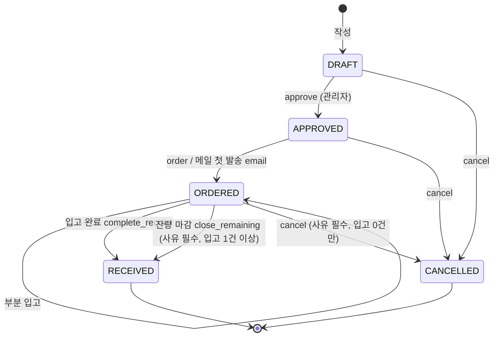

# 상태 머신 (State Machines)

> 2026-11-16 기준, main f4fce5d 코드에서 확인. #260 PR1. **동작을 바꾸지 않고 지금 동작을 그대로 적은 문서**다.
> 발주서 칸은 `backend/tests/test_po_transitions.py` 가 같은 내용을 자동 테스트로 고정한다. 문서와 테스트가 다르면 테스트(=실제 동작)가 맞다.

상태 머신: 정해진 상태 몇 개와, 어떤 동작이 어느 상태에서 어느 상태로 옮기는지의 규칙. 예) 발주서는 DRAFT 에서 승인하면 APPROVED 가 된다.

## 1. 발주서 상태 전이도

| 출발 | 동작 | 도착 | 권한 | 규칙이 있는 곳 |
|---|---|---|---|---|
| (없음) | 작성 | DRAFT | 둘 다 | `backend/app/services/purchase_orders.py:133` (공급업체당 DRAFT 1장) |
| DRAFT | 승인 approve | APPROVED | 관리자만 | `TRANSITIONS["approve"]` (`backend/app/services/po_states.py`) |
| APPROVED | 주문 완료 표시 order | ORDERED | 둘 다 | `TRANSITIONS["order"]` |
| APPROVED | 메일 첫 발송 성공 | ORDERED | 둘 다 | `TRANSITIONS["email"]` (발송 성공 뒤 `po_mail.send_order` 가 호출) |
| ORDERED | 입고로 모든 줄이 다 참 | RECEIVED | 둘 다 | `TRANSITIONS["complete_receipt"]` (`purchase_orders.receive_order` 가 호출) |
| DRAFT·APPROVED·ORDERED | 취소 cancel (입고 기록 0건일 때만, ORDERED 는 사유 필수) | CANCELLED | 둘 다 | `TRANSITIONS["cancel"]` + `purchase_orders.change_status` 의 사전 조건 |
| ORDERED | 잔량 마감 close_remaining (입고 기록 1건 이상일 때만, 사유 필수, #252) | RECEIVED | 둘 다 | `TRANSITIONS["close_remaining"]` + `purchase_orders.close_remaining` 의 사전 조건 |

RECEIVED·CANCELLED 는 끝 상태다(나가는 전이 없음). `order.status` 에 값을 쓰는 곳은 `purchase_orders.set_status` 한 곳뿐이다(표 확인 → 변경 이력 → 대입). `backend/tests/test_po_state_table.py` 가 코드 검색으로 이를 고정한다.

## 2. 상태별 되는 일 / 안 되는 일

○ = 됨, ✕ = 409 `INVALID_STATUS` (details `{"status": 현재 상태}`), 그 밖은 표에 코드를 적었다. 다른 회사 발주서는 어디서나 404, 로그인 없으면 401.

허용 상태의 출처: 상태를 바꾸는 동작(승인·주문 완료·메일 첫 발송·입고 완료·취소·잔량 마감)은 `TRANSITIONS`, 그 밖의 동작은 `ACTION_STATES` (둘 다 `backend/app/services/po_states.py`). `ACTION_STATES` 키: `edit`(수정), `email`(메일 발송·미리보기), `receive`(입고), `correct_receipt`(입고 정정), `document`(문서 보기·엑셀). 오류 문장은 각 호출 지점에 있다.

| 동작 (경로) | DRAFT | APPROVED | ORDERED | RECEIVED | CANCELLED |
|---|---|---|---|---|---|
| 수정 `PATCH /{id}` | ○ | ✕ | ✕ | ✕ | ✕ |
| 승인 `POST /{id}/approve` (관리자) | ○ (비활성 업체·품목이면 409 `INACTIVE_REFERENCE`) | ✕ | ✕ | ✕ | ✕ |
| 승인 — 담당자 | 403 `FORBIDDEN_ROLE` | 403 | 403 | 403 | 403 |
| 주문 완료 `POST /{id}/order` | ✕ | ○ → ORDERED | ✕ | ✕ | ✕ |
| 메일 발송 `POST /{id}/email` | ✕ | ○ → ORDERED | 409 `ALREADY_ORDERED` (resend=true 면 ○, 상태 그대로) | ✕ | ✕ |
| 입고 `POST /{id}/receipts` | ✕ | ✕ | ○ (부분이면 ORDERED, 다 차면 RECEIVED, 넘치면 409 `OVER_RECEIPT`) | ✕ | ✕ |
| 취소 `POST /{id}/cancel` | ○ | ○ | ○ 사유 필수(없으면 422), 입고 기록 있으면 409 `CANNOT_CANCEL_RECEIVED` | ✕ | ✕ |
| 잔량 마감 `POST /{id}/close-remaining` (#252) | ✕ | ✕ | ○ → RECEIVED. 사유 필수(없거나 공백이면 422), 입고 기록 0건이면 409 `NO_RECEIPTS` | ✕ | ✕ |
| 입고 정정 `POST /inventory-movements/{id}/corrections` | 입고 없음 | 입고 없음 | ○ | ✕ | 도달 불가 |
| 문서 보기·엑셀 `GET /{id}/document(.xlsx)` | ✕ | ○ | ○ | ○ | ✕ |
| 메일 미리보기 `GET /{id}/email` | ✕ | ○ | ○ | ✕ | ✕ |

- 권한: 승인만 관리자, 나머지는 관리자·담당자 둘 다 (`backend/app/api/purchase_orders.py:139-151`, 정정은 `backend/app/api/movements.py:77`).
- 검사 순서: 담당자 승인은 상태보다 권한을 먼저 본다(어느 상태든 403). 취소는 ① 상태 → ② 입고 기록 → ③ 사유 순이라, ORDERED + 입고 있음 + 사유 없음은 422 가 아니라 409 `CANNOT_CANCEL_RECEIVED`. 메일은 ① 상태 → ② `ALREADY_ORDERED` → ③ `NO_SUPPLIER_EMAIL` → ④ 503 `MAIL_NOT_CONFIGURED` → ⑤ 발송 실패 502 `MAIL_FAILED`(APPROVED 그대로).
- 잔량 마감 검사 순서: ① 상태 → ② 사유 → ③ 입고 기록. 취소와 정확히 반대 조건이다(입고 0건은 취소만, 입고 있으면 잔량 마감만). 전량 정정해 누적 입고가 0 이어도 입고 기록이 있으면 마감할 수 있다. 되돌리기는 없다.
- 잔량 마감 수량(#252): 저장하지 않고 줄별 `발주 − 누적 입고(입고 − 정정)` 로 계산한다(응답 `items[].closed_quantity`, RECEIVED 에서만 값, 그 외 null). RECEIVED 뒤에는 입고·정정이 모두 막혀(`ACTION_STATES["receive"]`·`["correct_receipt"]` 가 ORDERED 만) 이 값이 다시 바뀌지 않는다. `received_at` 은 마감한 날이 아니라 마지막 입고일(`purchase_orders.last_receipt_at`, 입고 완료와 같은 값). 변경 이력에는 status 행(사유 포함)과 남은 수량이 있는 줄마다 `items[SKU].closed_quantity`(없음 → 마감 수량) 행을 남긴다. 잠금은 발주서 하나뿐이라 입고·정정(발주서 → 품목 순)과 교착이 없다.
- **"CANCELLED + 입고 이력"은 도달 불가**: 입고 기록이 있으면 취소가 막히므로 API 로 만들 수 없다. 그래서 테스트도 없다.
- 상태 변경은 모두 `po_change_log` 에 `field="status"` 행(이전 → 이후)으로 남는다. 부분 입고와 메일 다시 보내기는 행이 없다.
- 승인 시 회사명 스냅샷(#263): 승인하면 `approved_by`·`approved_at` 과 함께 그때의 회사명을 `approved_company_name` 에 저장한다(문서 도장용, 새 상태·변경 이력 행 없음).

## 3. 표 밖 전이 2곳

없음. #260 PR2 에서 둘 다 전이표로 옮겼다(`test_po_transitions.py` 는 고치지 않고 그대로 통과).

| 전이 | 옮긴 위치 | 언제 바꾸는가 (그대로) |
|---|---|---|
| APPROVED → ORDERED (메일 첫 발송) | `TRANSITIONS["email"]`, `po_mail.send_order` 가 `set_status` 호출 | 메일이 실제로 나간 뒤에만. ORDERED 에서 다시 보내면 상태·이력 그대로 |
| ORDERED → RECEIVED (입고 완료) | `TRANSITIONS["complete_receipt"]`, `purchase_orders.receive_order` 가 `set_status` 호출 | 누적 입고량이 모든 줄에서 발주 수량에 닿을 때만 |

## 4. 알려진 이상 동작 (지금은 그대로 고정)

| # | 무엇 | 위치 | 연결 이슈 |
|---|---|---|---|
| 1 | ~~입고 기록이 한 번이라도 있으면 취소 불가. 전부 정정해 누적 입고가 0 이어도 막힌다. 잔량을 마감할 방법이 없어 부분 입고 발주는 ORDERED 로 남는다~~ → #252 에서 잔량 마감(`close_remaining`)으로 해결. 취소 불가는 그대로이고, 입고 기록이 있는 ORDERED 발주(전량 정정해 누적 입고 0 인 "꼼짝 못 하는 발주" 포함)는 사유를 적어 RECEIVED 로 닫는다 | `purchase_orders.change_status`, `purchase_orders.close_remaining` | #252 |
| 2 | RECEIVED 가 되면 입고 정정 불가(409 `INVALID_STATUS`). 마지막 입고를 잘못 넣으면 되돌릴 길이 없다. #260 PR3 부터 이력 응답의 `can_correct` 가 false 라 화면이 버튼을 숨길 수 있다(정정 불가 자체는 그대로) | `stock.create_correction`, `stock.enrich_movements` | #259 |
| 3 | ~~오류 문장에 영어 상태값이 섞인다~~ → #260 PR3 에서 `po_states.STATUS_NAMES` 로 한국어 상태명을 쓴다 (예: "작성 중인 발주서만 수정할 수 있습니다. 지금은 승인됨입니다.") | `purchase_orders.update_order`·`set_status`·`change_status`·`receive_order`, `stock.create_correction` | #259 |
| 4 | 거절 details 는 `{"status"}` 뿐이고 `CANNOT_CANCEL_RECEIVED`·`NO_SUPPLIER_EMAIL` 은 `null` (그대로 둔다: `test_po_transitions.py` 가 details 를 값 전체로 고정). 다음 할 일은 details 대신 발주서 응답의 `allowed_actions` 로 알린다(화면은 409 뒤 다시 불러온다) | 위 각 위치 | #259 |
| 5 | 공급업체당 DRAFT 1장: DRAFT 가 있으면 409 `DUPLICATE_DRAFT`, 그 발주서를 승인하면 새 DRAFT 를 만들 수 있다 | `purchase_orders.py:142-149` | #251 |
| 6 | 상태별 버튼 규칙이 화면에 따로 있다 (아래 5번 목록). 서버는 #260 PR3 부터 `allowed_actions` 를 주지만 화면 전환은 PR4 | 프런트 | #259 |

**allowed_actions (#260 PR3)**: 발주서 응답(목록·상세·추천 초안)에 `po_states.allowed_actions(status, role, has_receipts)` 결과가 들어간다. 값은 `edit, approve, order, cancel, close_remaining, email, receive, document` 중 지금 되는 것(이 순서). 상태 조건은 `TRANSITIONS`·`ACTION_STATES` 에서 읽고, 상태 밖 조건은 셋: 승인은 관리자만, 취소는 입고 기록 0건일 때만, 잔량 마감은 입고 기록 1건 이상일 때만(#252, 역할 무관). `email` 은 ORDERED 에서 다시 보내기를 뜻한다. `backend/tests/test_po_allowed_actions.py` 가 2절 표(`test_po_transitions.ALLOWED`)와 양쪽 방향으로 같은지 검사한다. `close_remaining` 은 PR1 행렬 이후에 생겨 행렬에 없고, `backend/tests/test_po_close_remaining.py` 가 같은 양쪽 방향 검사를 따로 한다. 새 동작을 넣으면 `allowed_actions` 와 그 테스트의 `MATRIX` 도 고친다.

## 5. 프런트가 상태를 직접 보는 곳

검색 범위: `frontend/app` 의 `*.ts·*.tsx` 에서 `status === / !== "상태"`, `[...].includes(status)`, 상태별 `ACTIONS` 표를 grep.

| 위치 | 하는 일 |
|---|---|
| `frontend/app/(app)/purchase-orders/[id]/page.tsx:21-24` | 상태별 버튼 표 `ACTIONS` (DRAFT 승인·취소, APPROVED 주문 완료·취소, ORDERED 취소) |
| `…/[id]/page.tsx:158` | 승인 버튼은 관리자만, 입고 기록 있으면 취소 버튼 숨김 |
| `…/[id]/page.tsx:72, 160-163, 233-234, 267` | DRAFT 경고, ORDERED 취소 사유 필수, 수정 링크(DRAFT), 문서 링크(APPROVED·ORDERED·RECEIVED), 안내 문구 |
| `frontend/app/(app)/purchase-orders/[id]/edit/page.tsx:26, 30` | DRAFT 일 때만 수정 폼 |
| `frontend/app/(app)/purchase-orders/[id]/document/page.tsx:50` | APPROVED·ORDERED 일 때만 메일 패널 |
| `frontend/app/(app)/purchase-orders/[id]/document/mail-panel.tsx:35` | ORDERED 면 다시 보내기 확인 |
| `frontend/app/(app)/purchase-orders/page.tsx:111` | ORDERED·RECEIVED 일 때 입고 현황 표시 |
| `frontend/app/(app)/suppliers/[id]/page.tsx:78` | ORDERED + 입고 있음 → "부분 입고" 표시 |
| `frontend/app/lib/po.ts:109` | ORDERED 일 때만 납기 지남 일수 계산 |

점검 보고는 "프런트 7곳"이라 했는데, 위 grep 으로는 파일 7개(같은 파일 안 여러 줄 포함)가 나왔다.

## 6. 암묵적 상태 머신 17개

"암묵적" = 상태 칸이나 전이표 없이 여러 칸·조건문으로 상태가 정해지는 것. 위치는 grep 으로 확인한 파일:줄만 적었다(검색 범위: `backend/app`, `frontend/app`).
위험도: 높음 = 틀리면 재고·돈·발주가 어긋남, 중간 = 보안·중복 처리, 낮음 = 표시·편의.

| # | 이름 | 상태 값 | 규칙이 있는 곳 | 위험도 |
|---|---|---|---|---|
| 1 | 발주서 상태 | DRAFT·APPROVED·ORDERED·RECEIVED·CANCELLED | 위 1~3절 | 높음 |
| 2 | 발주 줄 입고 진행 | 미입고 → 부분 → 다 참 (누적 입고 = 입고 − 정정) | `backend/app/services/purchase_orders.py:308`, `:345-372` | 높음 |
| 3 | 입출고 이력과 정정 | 원래 이력 → 일부 정정 → 전부 정정 (정정의 정정 불가) | `backend/app/services/stock.py:308`, `:318-357` | 높음 |
| 4 | 품목·공급업체 활성 | 활성·비활성 (새 발주만 막음, DRAFT 승인 때 검사) | `purchase_orders.py:136`, `:251-259`, `stock.py:142` | 중간 |
| 5 | 재고 상태 | NORMAL·SHORTAGE·UNKNOWN (+ 대시보드 장기재고·과잉재고) | `backend/app/services/recommend.py:125-133`, `backend/app/services/dashboard.py:27` | 중간 |
| 6 | 사용자 계정 | 활성·비활성, 임시 비밀번호(must_change_password) | `backend/app/models/user.py:27`, `:36`, `backend/app/services/users.py:33`, `:48` | 중간 |
| 7 | 로그인 세션과 잠금 | 정상 → 실패 누적 → 잠김(5회, 15분) | `backend/app/auth/lockout.py:12-13`, `:31` | 중간 |
| 8 | 관리자 OTP | 유예 중 → 코드 발급 → 확인/5회 실패 폐기, 재발송 3회 | `backend/app/services/login_otp.py:28-30`, `:41`, `:66`, `:98`, `:119` | 중간 |
| 9 | 비밀번호 재설정 링크 | 발급 → 사용/만료(30분)/새 링크로 무효 | `backend/app/services/password_reset.py:34-41`, `:63-66` | 중간 |
| 10 | 멱등 키 | 없음 → 잡힘(처리 중) → 응답 저장 / 오류면 롤백으로 사라짐 | `backend/app/services/idempotency.py:37`, `:48`, `:58` | 중간 |
| 11 | 가져오기 흐름 | 파일 검사 → 미리보기 → 확정 | `backend/app/services/product_import.py:72`, `:190`, `:199`, `backend/app/services/receipt_import.py:76`, `:280`, `:291` (판매 가져오기는 확인 못함) | 중간 |
| 12 | 슬랙 연결 | NONE → PENDING(코드 발급) → LINKED / 코드 만료 | `backend/app/services/slack_link.py:66-70`, `:150` | 중간 |
| 13 | 슬랙 채팅 발주 | 제안(토큰) → 확인(초안 생성) / 취소 / 만료(30분) | `backend/app/services/chat_order.py:3-6`, `:44`, `:160`, `:217`, `:237` | 높음 |
| 14 | 슬랙 이벤트·아침 DM 중복 | 처음 → 이미 처리함 (event_id, 날짜:사용자) | `backend/app/services/slack_events.py:4-6`, `:76`, `backend/app/services/slack_digest.py:5`, `:30` | 중간 |
| 15 | LLM 사용 가능 여부 | 켜짐·꺼짐·한도 초과 등 (DISABLED·DAILY_LIMIT·BUDGET·…) | `backend/app/services/llm.py:107`, `:133-135`, `:173`, `backend/app/slack_worker.py:46` | 낮음 |
| 16 | 메일 발송 기록 | 미발송 → 발송(마지막 1건만, 다시 보내면 덮어씀) | `backend/app/models/purchase_order.py:49-51`, `po_mail.py:159-174` | 중간 |
| 17 | 화면 상태 | 목록 쪽·검색·비활성 포함, 취소 패널 열림 등 | `frontend/app/lib/list.tsx:10-14`, `frontend/app/(app)/purchase-orders/[id]/page.tsx:159` (전체 목록은 확인 못함) | 낮음 |

점검 보고의 17개 이름과 실제 코드가 다른 점: 재고 상태는 코드 값이 NORMAL·SHORTAGE·UNKNOWN 세 개이고, 장기재고·과잉재고는 대시보드 집계로 따로 있다. 나머지는 이름대로 코드가 있었다.

## 7. 새 상태나 동작을 추가할 때 해야 할 일

- [ ] `backend/app/services/po_states.py` 의 두 표(`TRANSITIONS`, `ACTION_STATES`)에 넣고, 상태는 `purchase_orders.set_status` 로만 바꾼다(`order.status = …` 직접 대입 금지). 직접 대입하면 `backend/tests/test_po_state_table.py` 의 코드 검색 테스트가 실패한다.
- [ ] 권한(관리자만/둘 다)을 경로에서 정하고, 위 2절 표에 적는다.
- [ ] 거절 응답: HTTP 코드, 오류 코드, `details` 모양을 정한다. 기존 코드를 재사용할 수 있으면 재사용한다.
- [ ] 변경 이력 `po_change_log` 에 status 행을 남긴다.
- [ ] `backend/tests/test_po_transitions.py` 의 `ACTIONS`·`ALLOWED`·`OTHER` 에 칸을 추가한다. 단, PR1 행렬을 고정해 둔 경우에는 새 동작 전용 테스트 파일에서 같은 칸(상태 5 × 역할 2)을 검사하고, `test_po_state_table.test_transitions_match_matrix` 의 제외 목록에 넣는다(#252 `close_remaining` → `backend/tests/test_po_close_remaining.py`).
- [ ] `po_states.allowed_actions` 에 버튼 조건을 넣는다(상태 밖 조건이 있으면 4절 아래 설명에 적는다).
- [ ] 화면(5절 위치)의 버튼·표시 조건을 같이 고친다.
- [ ] 이 문서의 1~5절을 고친다.

## 8. 이 문서가 다루지 않는 것 (후속 PR 범위)

- 거절 `details` 표준화: 하지 않기로 했다(4절 4번). 응답에 `allowed_actions`·`can_correct` 추가는 #260 PR3 에서 했다
- 화면이 `allowed_actions` 로 버튼 표시 (#260 PR4, #259)
- 잔량 마감 (#252)

## 관련 이슈

- #260 상태 머신: 발주서 전이 규칙 한곳으로 모으기 + 문서화
- #252 잔량 마감
- #259 거절 응답·화면 버튼 표준화
- #251 공급업체당 DRAFT 1장 규칙
